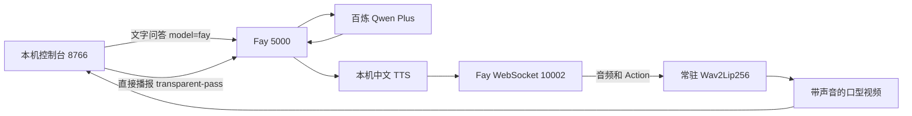

# Fay 真人 2D 数字人：使用与接入记录

## 打开与使用

双击 `avatar-2d/Start-DigitalHuman.cmd`，打开 `http://127.0.0.1:8766/`。若页面显示 Fay 核心未启动，点击“启动 Fay 核心”；等待“Fay 已连接”“口型已就绪”。

- **直接播报**：输入希望讲解员说的文本。实际由 Fay 调用本机中文语音，再输出动作和音频，数字人端生成口型后播放。
- **通义问答**：输入问题。通过 Fay 的 `model=fay` 接口进入其对话流程，使用本机保存的百炼配置，再由 Fay 生成语音和动作。不是绕过 Fay 直连模型。
- **动作预览**：单独播放迎宾、告别、摊手、轻点头素材，结束后回到对应休止姿态。轻点头仍是前段往返剪辑候选。
- **打断 / 停止**：立即停止浏览器播放，清空待播队列，通知 Fay 停止当前轮次，并撤销尚未完成的口型任务。Esc 也会触发打断。
- **全屏展示**：进入纯黑背景人物展示。浏览器 Esc 退出全屏，同时执行打断。

`Stop-DigitalHuman.cmd` 停止由该启动器记录的桥接进程及其子进程。Fay 管理服务有独立的 `fay-ue4/Stop-Fay.cmd` 入口。所有服务绑定 127.0.0.1。

## 当前角色与模型

当前角色设为女性展厅数字讲解员，风格专业、亲切、简洁。优先用简体中文，一般一到两句话回答；没有展馆资料时明确说明，不编造信息。可在 Fay 的 `/setting` 页面修改名称、角色和说明。

大模型使用 `qwen-plus`，经百炼官方兼容接口接入。默认北京地址为 `https://dashscope.aliyuncs.com/compatible-mode/v1`；不同地域/业务空间应使用对应官方地址和密钥。参考：[百炼子业务空间模型调用](https://help.aliyun.com/zh/model-studio/model-calling-in-sub-workspace)。

用户已通过本机页面保存密钥。页面不返回密钥，测试报告也不包含密钥。修改模型配置不会自动发起付费模型请求；点击“通义问答”才进入实际问答流程。

当前语音由 **Windows 本机中文 SAPI** 合成；百炼用于大模型回答。麦克风自动采集保持关闭，本轮交付为文字输入。云端音色、麦克风 ASR 和知识库接入需要后续分别配置与验证。

## 接口与动作映射



Fay 音频消息保持 `Topic=human`、`Data.Key=audio`，接收 `Value`、`Text`、`Action`、`CONV_ID`、`CONV_MSG_NO`。桥接使用独立用户 `Avatar2D`，只接受该用户且位于本机 Fay `samples` 目录中的音频。

| Fay 动作 code | 本地素材 |
|---|---|
| greeting.hello / greeting.welcome / guidance.invite | welcome-wave |
| farewell.goodbye | goodbye-wave |
| dialogue.explain / dialogue.recommend / dialogue.summary | explain-open-palms |
| dialogue.confirm | acknowledge-nod |
| 其他未映射信号 | 保持休止姿态说话 |

同一回答的动作只在首个音频片段触发，后续分句保持休止姿态。动作完成一次后不重复挥手；语音较长时继续在该动作末尾姿态上驱动嘴部。语音较短时在音轨末尾补静音，让身体动作自然播完。播放完成恢复闭嘴的原素材休止帧。

单窗口拥有播放权；从另一窗口提交播报、问答或动作会接管。服务只把可播放视频事件发送给当前控制窗口，避免多个控制台同时出声。管理页更新后应刷新旧页面。

## 已完成的实际验证

`fay-integration-validation-v1.json` 记录了真实本机 Fay → SAPI → WebSocket → GPU → H.264/AAC 的四动作测试，没有使用模拟 Fay：迎宾 175 帧、告别 175 帧、摊手 225 帧、点头 100 帧，共 675 帧，全部通过严格音视频解码和帧数检查。另验证了正在推理的任务取消后不再发送迟到的可播放结果。

`single-playback-validation-v1.json` 用两个实际 WebSocket 客户端验证只有控制窗口接收到可播放事件。

真实百炼问答已返回讲解员回答，文字在控制台显示，分句语音生成口型并在浏览器播放完成。最终验收记录保存在 `cloud-dialogue-validation-v1.json`，界面截图保存在本目录。验证的是浏览器播放事件和媒体解码；人工听感、逐音素自然度及现场扬声器效果未替代验收。

复核入口：

```powershell
.\avatar-2d\.venv\Scripts\python.exe avatar-2d/tests/check_fay_integration.py
.\avatar-2d\.venv\Scripts\python.exe avatar-2d/tests/check_single_playback.py
```

两个脚本使用固定的本机播报文本，不主动调用百炼。真实问答验证通过控制台执行。

## 运行边界

当前采用“生成短片段后播放”，模型常驻显存，尚未实现 WebRTC 边生成边播放。四条本机固定播报测试从提交到成片约 4.8–10 秒（含冷批次与素材动作长度），不包含之后的播放时长。实际云问答还包含模型返回时间；编码为 25 fps 不代表端到端首音实时。

开发机为 RTX 5060 Laptop GPU；GTX 1660 6 GB、8 GB 内存目标机的性能和长时间稳定性未验证。当前待机采用与动作同源的休止画面，长期自然呼吸循环仍可继续完善。

知识库、向量索引、外部业务工具和麦克风 ASR 均未在本轮验收。Fay 的仿生记忆开关保持关闭，不能把历史代码中的模拟向量回退视为知识库已可用。

## 本机兼容修复与保留记录

修改仅位于当前本地运行副本和项目脚本；上游压缩包、vendor 源码和原始视频保留。

- 增加显式 `windows_sapi` 语音适配器，不覆盖 Azure/Edge 的原模块。
- Fay 在记忆关闭时跳过记忆预热、定时调度及旧记忆恢复。
- 模型辅助客户端在使用时读取最新凭据，避免启动时空配置被缓存。
- 无活动会话时不插入无归属的结束标记；文字流按会话 ID 过滤，防止首次问答提前结束。
- 兼容 Fay 状态接口以 text/html 返回 JSON 的现有行为。
- Windows 启停脚本显式按 UTF-8 读取中文路径状态文件，保留进程创建时间、路径身份校验，并处理子进程退出导致的父进程退出竞争。

原始运行代码和首次配置备份位于 `runtime/fay-2d-integration-backup-v1`，最初创建时尚未配置百炼密钥。不要对已配置的部署重复执行首次准备脚本。生成会话保存在 `runtime/sessions`，没有自动清空原始素材或历史样片。
