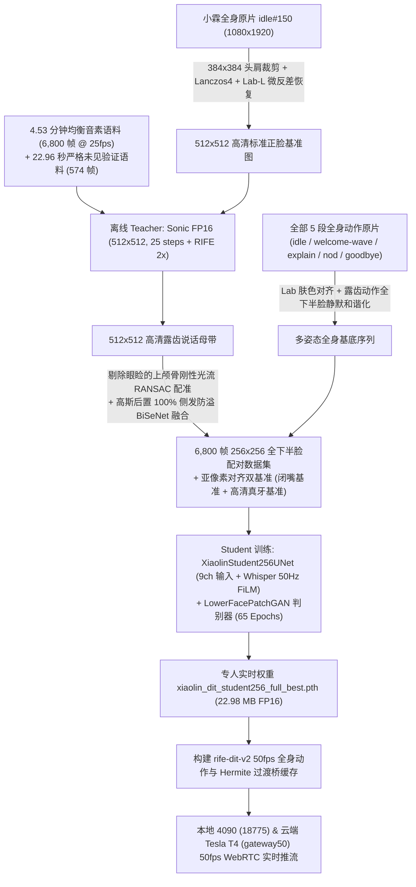

# 小霖 DiT-v2 嘴部与全下半脸专人权重生成方法

整理日期：2026-11-16。本文档完整记录穿裙子全身真人小霖（`1080×1920 @ 50 fps`）第二代 **DiT-v2（512×512 `Sonic` 离线扩散母带 → 256×256 双基准 PatchGAN 专人轻量实时模型）** 的设计原理、四阶段训练管线、关键算法细节、复现命令及双端（本地 RTX 4090 / 云端 Tesla T4）实时接入规范。

---

## 1. 背景与前两代方案痛点复盘

在保持既有真人全身动作视频（`idle`、`welcome-wave`、`explain-open-palms`、`acknowledge-nod`、`goodbye-wave`）不变、且必须同时满足云端单张 **Tesla T4 稳定 `50 fps` 实时 WebRTC 推流**与本地 **RTX 4090** 运行的前提下，前两代方案存在以下核心瓶颈：

1. **第一代正式基线（`Wav2Lip256` + `DISOpticalFlow`）**
   - 仅重绘嘴唇局部小框，口腔内部糊成粉白色块，无清晰门牙结构；
   - 依赖音频能量阈值硬切（`rms > 0.004`），在原本带露齿大笑的 `welcome-wave`、`goodbye-wave` 上说话与停顿切换时出现明显牙齿闪现与双下巴重影。
2. **首轮蒸馏试验（`xiaolin-distill-v1`：零样本 `MuseTalk 1.5` → `192×192` 单基准 L1 UNet）**
   - Teacher 采用零样本 `MuseTalk 1.5`，本身缺乏高清个体齿列细节与大张口下颌延伸感；
   - Student 仅使用闭嘴单基准输入 + 确定性像素损失（L1 + Sobel + VGG，无对抗判别器），导致多帧相位微小差异被平均成乳白色软块；
   - 重绘遮罩仅覆盖嘴唇及下唇下方窄区，在 `welcome-wave` 等高耸苹果肌微笑帧上贴入平静闭嘴模型输出时，上半脸笑肌与下半脸口型产生割裂感。

---

## 2. DiT-v2 总体技术路线

DiT-v2 保留“**重型离线大模型造专人母带 → 蒸馏超轻量实时专人 UNet**”的架构方向，完成三项根本性升级：

1. **Teacher 升级为离线全局音频扩散大模型 `Sonic`（CVPR 2025，`512×512`）**：在离线阶段不计耗时（4.53 分钟均衡音素语料在 4090 上约跑 55 分钟），生成门牙颗粒分明、口腔暗部纵深真实、苹果肌与下巴颏随元音自然伸缩的高清说话母带。
2. **重绘与融合区域扩大至“鼻翼下全下半脸（`256×256` 原生 1:1 像素密度）”**：覆盖双侧苹果肌、法令纹、人中、上下唇、牙齿及动态下巴颏，并采用颧骨宽、下颌收窄的 V 型解剖遮罩与高斯后置侧发轮廓保护，彻底消除笑肌断层与发丝亮边。
3. **Student 升级为 9 通道双基准（闭嘴基准 + 高清真牙基准）ResUNet + Audio-FiLM + 谱归一化 PatchGAN**：把小霖专属高清真牙纹理直接作为条件先验送入输入通道，配合局部对抗损失与多尺度特征匹配损失消除 L1 模糊，同时维持 **`4.65 ms / 4 帧`（4090 实测 `860.6 FPS`，Tesla T4 折算约 `241 FPS`）** 的超高速推理能力。



---

## 3. 代码结构与模块职责

生成与部署相关脚本位于以下两个独立目录，不侵入旧版 `xiaolin-distill-v1`：

| 路径 | 职责说明 |
| :--- | :--- |
| `avatar-2d/experiments/xiaolin-dit-v2/step0_setup_and_download.py` | 隔离依赖安装、国内 ModelScope 镜像源拉取 `SVD-XT FP16` 与 `Sonic` 权重、显存占用校验 |
| `avatar-2d/experiments/xiaolin-dit-v2/step1_build_hd_refs_and_sonic_teacher.py` | 提取 `512×512` 高清正脸基准图，流式显存受控调用 `Sonic` 生成说话母带与抽帧核验图 |
| `avatar-2d/experiments/xiaolin-dit-v2/step2_align_and_build_dataset256.py` | 亚像素上颅骨刚性配准、BiSeNet 全下半脸语义融合、双基准图优选与 `256×256` 数据集制作 |
| `avatar-2d/experiments/xiaolin-dit-v2/xiaolin_student256_gan.py` | `XiaolinStudent256UNet`（9 通道双基准 ResUNet + Audio-FiLM）、`LowerFacePatchGANDiscriminator` 及 V 型解剖遮罩定义 |
| `avatar-2d/experiments/xiaolin-dit-v2/step3_train_gan256_and_preview15s.py` | 16 秒多动作快速闭环训练与三代方案（`Wav2Lip256` vs `v1` vs `DiT-v2`）50fps 同屏对比渲染 |
| `avatar-2d/experiments/xiaolin-dit-v2/step4_full_body_production_pipeline.py` | **全量生产主脚本**：串联 4.53 分钟全量 `Sonic` 母带分段断点合成、5 动作全量对齐、65 轮 GAN 训练、`rife-dit-v2` 50fps 全身缓存构建与 33 秒四动作验收片渲染 |
| `deploy/t4-cloud/dit-v2/` | 云端 Tesla T4 50fps 实时推理引擎（`engine50_dit_v2.py`、`render50_dit_v2.py`）、T4 本地缓存构建器与蓝绿无损切换/一键回滚脚本 |
| `deploy/lan-4090-dit-v2/` & `Open-Xiaolin-4090-DiTv2.cmd` | 局域网 RTX 4090 独立端口（`18775`）50fps 实时语音对话启动器与计划任务注册脚本 |

---

## 4. 四阶段生成方法详解

### 4.1 阶段零：模型依赖与离线权重准备

在训练机（RTX 4090，建议空闲显存 `>= 14 GiB`）准备以下离线权重至 `vendor/Sonic/checkpoints/`：

- `stable-video-diffusion-img2vid-xt/`：`vae/diffusion_pytorch_model.fp16.safetensors`、`image_encoder/model.fp16.safetensors`、`unet/config.json`、`scheduler/`、`feature_extractor/`（无需下载冗余的原版 SVD UNet 权重，直接由 `from_config` 加载 `Sonic/unet.pth` 即可省去 2.9 GB 下载）。
- `Sonic/`：`unet.pth`、`audio2token.pth`、`audio2bucket.pth`。
- `yoloface_v5m.pt`、`whisper-tiny/`、`RIFE/flownet.pkl`。
- PyTorch Hub 缓存 `~/.cache/torch/hub/checkpoints/vgg16-397923af.pth`（用于训练期多尺度感知损失）。

### 4.2 阶段一：512×512 高清标准脸制作与 `Sonic` 离线母带合成

1. **高清无色偏正脸基准提取（`canonical_portrait_512.png`）**
   - 从 `idle.mp4` 第 `150` 帧（眼神明亮、唇线自然闭合微笑）按人脸框中心截取原生 `384×384` 正方头肩区域，`Lanczos4` 插值放大至 `512×512`。
   - 转入 CIE `Lab` 空间，**仅对亮度通道 `L` 做小半径（`sigma=1.3`，权重 `0.30`）高频微反差恢复**，`a/b` 色度通道保持 100% 原值不变，既提升唇缘细节清晰度，又杜绝超分模型常见的假皮感或肤色漂移。
2. **显存受控的混合精度 `Sonic` 分段合成**
   - `UNetSpatioTemporalConditionModel`、`AutoencoderKLTemporalDecoder`、`CLIPVisionModelWithProjection` 运行于 `FP16`（`decode_chunk_size=4`）；`Whisper-tiny`、`audio2token`、`audio2bucket` 保持 `FP32` 精度以严格对齐官方音频桶映射。
   - **流式 RIFE 插帧改造**：原版 `Sonic` 会把整段视频张量一次性搬上 GPU 做 12.5→25fps RIFE 插帧，长音频极易爆显存。管线改为在 CPU 持有解码帧，逐对 `(I1, I2)` 送上 GPU 插帧并即时写入 `FFmpeg` H.264 管道，使 32 秒片段峰值显存稳定在 **`12.8 GB` 以内**。
   - **句间静默谷值自动分段**：将 `272.0s`（`6,800` 帧）均衡音素训练音频按约 `32s` 搜索能量最低的帧对齐静默点切分为多段，每段生成后独立落盘缓存（`teacher/full_chunks/`），支持任意时刻断点续跑。

### 4.3 阶段二：亚像素上颅骨刚性锁定与全下半脸无痕融合

由于 `Sonic` 生成的 `512×512` 说话母带自带自然的轻微头部呼吸摆动，若直接裁嘴贴回全身视频会产生五官错位与双下巴重影。阶段二通过三步几何与光度变换将其严丝合缝投射到全部 5 段全身动作的每一帧上：

1. **剔除眼睑干扰的上颅骨刚性锚点锁定**
   - 使用 `BiSeNet` 语义分割提取额头、眉弓与上鼻梁区域（`y < nose_y - 12`），**显式将左/右眼（类别 4、5）膨胀 `13×13` 像素后剔除**，确保全身原片中的自然眨眼动作完全不会干扰刚性头姿估计。
   - 先用 `YoloFace` 左眼、右眼、印堂三点估计粗相似变换 `M_coarse`，再用双向金字塔 `LK` 光流（前后向重投影误差 `< 1.5 px`）配合 `RANSAC` 估计亚像素级 `2×3` 刚性相似矩阵 `M_sonic_to_pose`，锁死上颅骨零漂移。
2. **局部肤色传递 + 高斯后置 100% 侧发轮廓保护（`compose_sonic_onto_pose_512_v2`）**
   - 在鼻梁与眼下上颊交集区统计 `Lab` 中值差，温和补偿各动作片段与 `idle` 间的局部光照微差，同时对口腔内牙齿像素（`seg == 11`）施加 `88%` 保护权重防止白牙染黄。
   - 语义掩膜覆盖整个下半脸（皮肤 `1` + 鼻尖 `10` + 口腔牙齿 `11` + 上唇 `12` + 下唇 `13`），允许下巴随大开口向颈部皮肤（`seg == 14`）自然下探，但**在高斯羽化之后乘以膨胀羽化后的原帧黑发掩膜 `(1.0 - hair_guard)`（`pose_seg == 17`）**，100% 阻断脸颊肤色向两侧深色披肩发丝溢出。
3. **露齿动作基底静默和谐化与双基准提取**
   - 对原始画面带露齿笑的 `welcome-wave`、`goodbye-wave`、`acknowledge-nod` 基底帧，预先用刚性对齐的 `canon_512` 闭嘴微笑帧做全下半脸和谐化，从根源消除静默态与说话态之间的苹果肌跳变。
   - 按 `get_student_box256`（在原生 `coords.json` `[y1, y2, x1, x2]` 基础上左右各扩 `22px`、上扩 `4px`、下扩 `24px`，约 `197×248` 原生像素映射至 `256×256`）导出配对序列 `(src_256, tgt_256)`，并按 `Laplacian清晰度 × 齿面85分位亮度 × 口腔面积` 自动优选出全库最锐利的真牙帧生成 `canonical_teeth_ref_256.npy`。

### 4.4 阶段三：`256×256` 双基准 ResUNet + PatchGAN 训练

1. **模型结构（`XiaolinStudent256UNet`，`11.70M` 参数，`22.98 MB` FP16）**
   - **9 通道输入**：`[masked_pose_bgr(3), canonical_closed_ref_bgr(3), canonical_teeth_ref_bgr(3)]`。其中 `build_lower_half_hide_mask_256()` 采用上宽下窄 V 型解剖遮罩（颧骨苹果肌半宽 `rx=90` 平滑收窄至下巴 `rx=65`，严格保护 `y < 96` 的双眼与两侧外发丝）。
   - **双路 Whisper 50Hz 注入**：`WhisperDualProjector` 对每帧 `10×5×384`（`200ms` 窗口，含 5 层 Encoder 特征可学习加权）提取 `16×16` 空间发音特征图（拼接至瓶颈层）与 `256` 维全局音素向量（通过零初始化 `AudioFiLM` 仿射调制注入 `32×32` 与 `64×64` 解码层，强化唇齿高频边缘）。
2. **复合损失与训练策略（65 Epochs，每批 16 组相邻帧对 = 32 张图）**
   - **分区加权像素 L1**：基础权重 `1.0`，下半脸苹果肌/下颌区 `+4.5`，核心唇齿区 `+11.0`（最高 `16.5×`）。
   - **高频与感知约束**：`0.40 × Sobel 边缘损失` + `0.14 × 离线 VGG16 (relu1_2/2_2/3_3) 下半脸感知损失` + `2.2 × 相邻帧时序速度一致性损失`。
   - **PatchGAN 局部对抗精修**：前 14 轮仅跑重建预热稳定几何结构；第 15 轮起接入谱归一化 `LowerFacePatchGANDiscriminator`（聚焦 `[84:244, 24:232]` 下半脸区域），叠加 `0.025 × Hinge 对抗损失` + `0.25 × 4 层判别器特征匹配损失`，令门牙缝隙与唇珠高光保持锐利且零时序闪烁。
   - **在线流式静音校准**：每批固定替换 `14%` 样本为跨动作静默恒等对，静音特征池同时包含自然录音静音窗与在线 `FastWhisper50Hz`（`t=28.0s` 注入 `0.28` 正弦校准脉冲防止 `log_spec.max()-8.0` 动态范围坍塌）静音窗，保证 WebRTC 实时对话打断或停顿后嘴唇 100% 严密闭合。

### 4.5 阶段四：50fps 全身动作缓存与实时引擎接入

1. **50fps 全身素材缓存（`rife-dit-v2`）**
   - 待机环：截取无瑕疵闭嘴段 `idle[104..304]` 经 RIFE v4 超采至 50fps 并做首尾零跳变镜像，构成 `800` 帧（分为 `0..400` 与 `400..800` 两段兼容 `IdleScheduler`）。
   - 动作库：4 个动作先在 25fps 做 Lab 肤色校准与 `XiaolinStudent256UNet` 静默全下半脸和谐化，再经 RIFE v4 升至 50fps。
   - 运动学过渡桥：自动筛除眨眼帧（瞳孔暗像素比 `< 0.80 × 中位数` 禁用为锚点），按姿态与速度联合代价最小化生成 `184` 条 20 帧递归 RIFE v4 三次 Hermite 过渡桥（共 `3,680` 帧）。
2. **50fps 实时渲染包络（`render50_dit_v2.py`）**
   - 利用已缓冲的 `200ms` 音频前瞻实现说话前 10 帧闭嘴平滑切入；说话期间及语音结束后 **22 帧（`440ms`）保持 `alpha = 1.0`**，由模型自身根据静音特征完成真实的几何闭嘴动作（绝不在张嘴状态做半透明叠化），随后在完全闭嘴状态下用 8 帧平滑淡回 `0.0`，纯待机阶段零 GPU 推理开销。

---

## 5. 标准复现命令（RTX 4090）

在具备原片资产（`F:\xiaolin\app\avatar-2d`）与均衡音素语料的 4090 机器上，按序执行以下两条命令即可从零复现完整权重与 50fps 缓存：

```powershell
# 1. 环境初始化与基础扩散权重拉取校验（首次执行）
F:\xiaolin\venv\Scripts\python.exe -u F:\xiaolin\dit-distill-v2\step0_setup_and_download.py

# 2. 一键运行全量四阶段生产流水线（4.53分钟 Sonic 母带 -> 6800帧多姿态对齐 -> 65轮双基准GAN训练 -> 50fps全身缓存与33秒验收片）
F:\xiaolin\venv\Scripts\python.exe -u F:\xiaolin\dit-distill-v2\step4_full_body_production_pipeline.py
```

产出的核心正式权重为：
- `F:\xiaolin\dit-distill-v2\checkpoints\xiaolin_dit_student256_full_best.pth`（`22.98 MB` FP16，内置 `model_fp16` 权重字典及 `canonical_closed_ref_256`、`canonical_teeth_ref_256` 双基准数组，单文件自包含）。

---

## 6. 实测验收指标与版本库管理规范

### 6.1 实测指标汇总

| 评估项 | 实测结果 |
| :--- | :--- |
| 训练 / 未见验证规模 | `6,800` 帧（`272.00s`） / `574` 帧（`22.96s`），覆盖全部 5 段全身视频 |
| 未见验证集全图 PSNR | **`33.72 dB`**（较 16s 原型版 `+2.77 dB`） |
| 未见验证集下半脸 L1（苹果肌+法令纹+下颌） | **`0.01214`** |
| 未见验证集核心唇齿区 L1 | **`0.02545`** |
| 专人模型文件体积（FP16 含双基准） | **`22.98 MB`** |
| 实时推理吞吐（FP16，`batch=4`） | RTX 4090：**`860.6 FPS`（`4.65 ms/批`）**；单张 Tesla T4：约 **`241 FPS`** |
| 端到端全动作展示验收 | 33.00 秒（`1,650` 帧 @ 50fps）连续触发全部 4 个全身动作与 8 次过渡桥零异常 |

### 6.2 Git 提交边界规范

- **纳入版本库**：`avatar-2d/experiments/xiaolin-dit-v2/` 全部训练与对齐源码、`deploy/t4-cloud/dit-v2/` 云端蓝绿发布脚本、`deploy/lan-4090-dit-v2/` 4090 实时启动脚本、`Open-Xiaolin-4090-DiTv2.*` 及本文档。
- **不纳入版本库（通过 `.gitignore` 排除）**：大体积模型权重（`*.pth`、`*.pkl`、`*.safetensors`）、训练缓存与视频产物（`*.npy`、`avatar-2d/outputs/`）、服务器运行态与密钥配置（`**/system.conf`、`runtime/`）。
