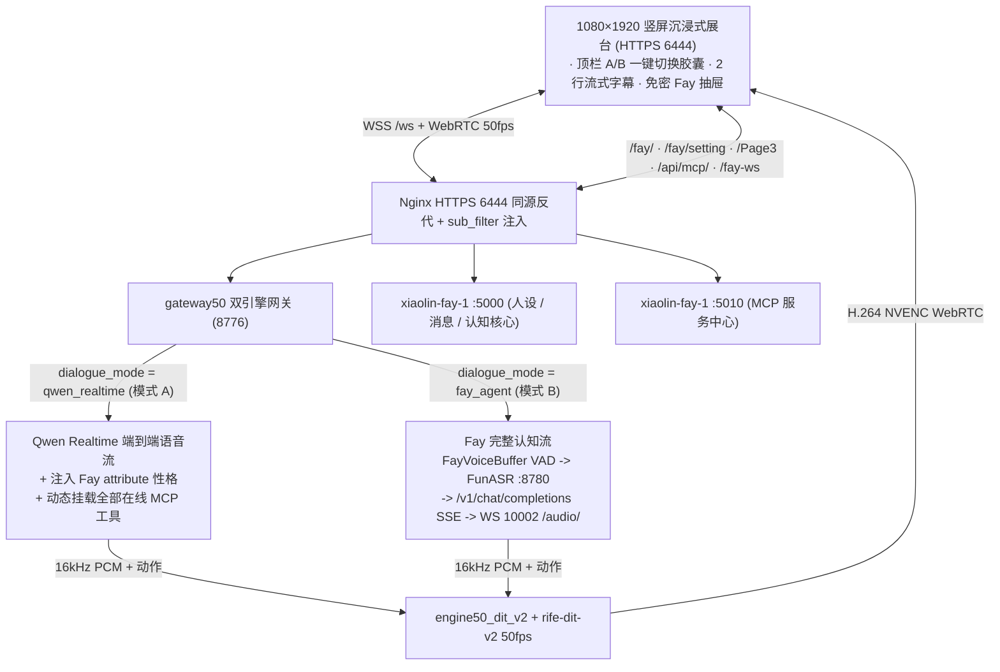

# 小霖双引擎（Qwen / Fay）接入、免密管理台与 1080×1920 竖屏字幕前端说明

整理日期：2026-11-17。本文档记录**穿裙子全身小霖（`1080×1920 @ 50fps DiT-v2`）**正式版服务（`https://36.133.88.94:6444/`）的双对话引擎切换架构、Fay 性格与通用 MCP 联动实现、同源免密 Fay 管理代理以及 `1080×1920` 竖屏沉浸式字幕前端的完整设计与线上实测结果。

---

## 一、 整体架构：A / B 双大脑 + 统一 50fps 全身渲染底座

无论切换至模式 A 还是模式 B，底层的 **`1080×1920 @ 50fps` WebRTC 视频推流与 `XiaolinStudent256UNet`（`DiT-v2`）口型渲染管线全程保持不断流**；网关层（`gateway.py` / `gateway50.py`）通过 `dialogue_mode` 状态实时路由对话与音频引擎：

---

## 二、 核心模块与技术细节

### 1. 模式 A（`qwen_realtime`，默认）：极速语音 + Fay 性格同步 + 通用 MCP 发现
对应源码：[fay_bridge.py](../../avatar-2d/experiments/qwen-realtime-v2/fay_bridge.py)、[capabilities.py](../../avatar-2d/experiments/qwen-realtime-v2/capabilities.py)、[gateway.py](../../avatar-2d/experiments/qwen-realtime-v2/gateway.py)

1. **Fay 性格/人设同步（`fetch_persona` / `format_persona_prompt`）**：
   - 从本机 `http://127.0.0.1:5000/api/get-data` 读取 Fay `config.attribute` 的 12 项人设属性（`name`、`gender`、`age`、`birth`、`zodiac`、`constellation`、`job`、`position`、`goal`、`hobby`、`contact`、`additional`），动态拼装为系统指令替换原先固定写死的台词。
   - 若服务端人设仍为原始占位值 `Feifei` 且无补充描述，服务启动时自动调用 `/api/submit`（使用 `application/x-www-form-urlencoded` 表单字段 `data`）初始化默认小霖人设；若用户已在 Fay 后台自定义人设（如线上当前 `数字讲解员`），则严格保留现有设定不覆盖。
   - 注意 Fay 的 `/api/get-data` 默认以 `text/html` MIME 返回 JSON，因此跨服务读取统一使用 `json.loads(await resp.text())`。
2. **Fay 通用 MCP 工具自动发现与容错调用（`fetch_mcp_tools` / `execute_mcp_tool`）**：
   - 实时请求 `http://127.0.0.1:5010/api/mcp/servers/online/tools`，筛选 `enabled == true` 且 `available == true` 的全部在线工具。
   - 通过 `sanitize_tool_schema()` 清洗 `$schema`、`$defs`、联合类型等非标准 JSON Schema 字段，映射安全函数名（`mcp__<name>`）并注入 `Qwen Realtime` 的 `tools` 列表。
   - **双重 Schema 兜底机制**：在 `Session.start()` 连接百炼 `Qwen Realtime` 时，若第三方 MCP 的 `inputSchema` 导致 `session.update` 被拒绝，自动降级为仅绑定 `coordinate_turn` 工具并通过其扩展字段 `mcp_tool` + `mcp_args_json` 转发调用 `Router.call_mcp()`，确保第三方工具永不阻断模式 A 建连。

### 2. 模式 B（`fay_agent`）：完整 Fay 认知引擎接入 50fps 渲染
1. **生命周期与可编辑锁联动（`ensure_fay_live`）**：
   - 切换至模式 B 时自动检查 `POST http://127.0.0.1:5000/api/get-run-status`，必要时调用 `/api/start-live` 拉起 Fay 核心。
   - 切换回模式 A 时自动调用 `/to-stop-talking` 与 `/api/stop-live`，释放 Fay 原生人设界面（`setting.html`）的运行期只读锁（`liveState = 0`）。
   - **MCP 断连自动恢复（`reconnect_mcp_servers`）**：由于 Fay 源码 `fay_booter.stop()` 会主动断开所有 `:5010` MCP 客户端连接，`ensure_fay_live(False)` 与 `Gateway.startup()` 在停用 live 后会自动重新连接此前在线或配置为 `autostart` 的 MCP Server，保证切回模式 A 后所有 MCP 工具持续可用。
2. **服务端 VAD + FunASR + Fay 流式问答与音频桥接（`FayVoiceBuffer` / `FayTurnRunner`）**：
   - **唤醒与连续语音分句**：未唤醒时沿用 `WakeBuffer` + 本机 `FunASR`（`127.0.0.1:8780`）检测“小霖小霖”；唤醒后在模式 B 下进入 `FayVoiceBuffer`（16kHz RMS 能量阈值与 550ms 静音判停），支持讲话插话打断（自动调用 `/to-stop-talking` 与 `/api/execution-cancel`）。
   - **上下文防陈旧（`avatar_context`）**：向 `http://127.0.0.1:5000/v1/chat/completions`（`model="fay"`、`user="Avatar2D"`、`stream=True`）携带当前轮次 `session.actions.context(turn['epoch'])`，流式转发 SSE `delta.content` 驱动实时字幕。
   - **音频与动作采集**：监听 `ws://127.0.0.1:10002`（注册 `{"Username": "Avatar2D", "Output": true}`），按响应中文件名通过 `http://127.0.0.1:5000/audio/<basename>` 拉取音频，通过 `decode_audio_to_pcm16k()`（支持 WAV 及经 PyAV 解码的压缩音频）统一转为 `16kHz` 单声道 PCM 与动作信号送入 `engine50_dit_v2`；若文本生成结束 `1.8s` 内未收到音频，自动回落 `synthesize_fallback_pcm16k()` 合成语音播报。
3. **WebRTC 零断流热切换**：
   - 在 `Gateway.settings_api()` 中，仅修改 `dialogue_mode`、大模型版本或能力开关而不更换 `lipsync_backend` 时，不关闭现有 `RTCPeerConnection` 与 `HumanPlayer`，仅停止当前对话轮次并同步后台引擎，保持页面 50fps 画面零黑屏、零重连。

### 3. 免密 Fay 原生可视化管理入口（`https://36.133.88.94:6444` 同源代理）
对应文件：[fay-https-shim.js](../../avatar-2d/experiments/qwen-realtime-v2/fay-https-shim.js)、[activate-dit-v2-fay-release.py](../../deploy/t4-cloud/dit-v2-fay/activate-dit-v2-fay-release.py)

为避免在云防火墙额外暴露 `5000` / `5010` / `10003` 明文端口以及触发 HTTPS 混合内容拦截，在 Nginx `6444` 端口同源反代 Fay 原生界面（当前按需求未设置访问密码）：

| 路由 | 上游目标 | 作用与兼容处理 |
| :--- | :--- | :--- |
| `/fay/`、`/fay/setting`、`/setting` | `127.0.0.1:5000` | 原生 Fay 消息记录与性格人设控制台；`Accept-Encoding ""` + `sub_filter` 自动注入 `/fay-https-shim.js` |
| `/Page3`、`/api/mcp/` | `127.0.0.1:5010` | 原生 Fay MCP 服务管理页面及增删启停接口，同样注入 `/fay-https-shim.js` |
| `/fay-ws` | `127.0.0.1:10003` | Fay 页面 WebSocket 状态通道（自动升级为同源 `WSS`） |
| `/static/` | `127.0.0.1:5000` 主 + `5010` 404 回退 | 使用 `proxy_intercept_errors on` 与 `@faymcp_static` 合并加载两边静态资源 |
| `/experiments/50fps/` | `127.0.0.1:8788` | 保留手动 50fps 预览路径 |

注入脚本 `/fay-https-shim.js` 会劫持 `fetch`、`XMLHttpRequest`、`WebSocket` 与左侧导航栏链接，将硬编码的 `:5000` / `:5010` / `:10003` 自动改写至当前 HTTPS/WSS 同源，并在保存人设（`/api/submit`）或变更 MCP（`/api/mcp/*`）成功时通过 `window.parent.postMessage({type: 'xiaolin_fay_updated'})` 通知主展台即时调用 `POST /api/fay/sync` 刷新人设和工具数。

### 4. `1080×1920` 竖屏沉浸式前端与电影级双行字幕
对应文件：[index.html](../../avatar-2d/experiments/qwen-realtime-v2/index.html)、[demo.js](../../avatar-2d/experiments/qwen-realtime-v2/demo.js)

- **自适应 `9:16` 展示舞台**：在竖屏终端（立式大屏 / 手机）全屏铺满 `100vw × 100dvh` 展示全身；在横屏桌面端居中锁定 `9:16` 圆角画框并配径向柔光氛围背景，内置悬浮「开启声音」提示与右侧滑出式工作台抽屉（「对话」「模型与能力」「知识与记录」）。
- **顶部悬浮玻璃 HUD**：实时展示当前人设名称（`#persona-name`）、状态、动作标签、**「⚡ 极速语音 / 🧠 Fay 认知」一键切换器**，以及声音、字幕模式、🎭 人设弹窗、🔌 MCP 弹窗（含在线工具角标）、⚙️ 工作台、全屏开关。
- **底部实时字幕（`formatSubtitleWindow`）**：固定于人物裙摆下方安全带，展示用户当前输入/识别气泡及小霖回答字幕；超长语句自动按中文标点分句并滑动保留最近 **2 行**焦点字幕，支持顶部按钮切换 **`智能淡出（4.2 秒）` / `常驻显示` / `关闭字幕`**。

---

## 三、 云端 T4 蓝绿上线状态与验收证据

- **正式发布目录**：`/opt/xiaolin/releases/formal50-dit-v2-fay-20261117-131220`（通过 `os.link` 零拷贝复用既有 33 GiB `rife-dit-v2` 全身缓存）
- **正式运行容器**：`xiaolin-formal50-dit-v2-fay`（监听 `127.0.0.1:8776`，GPU1 Tesla T4）
- **清理与回退**：已移除旧裤装版停止容器 `xiaolin-presenter-1`，并将旧 8766 `realtime-ingress.json` 归档迁移；上一版正式容器 `xiaolin-formal50-dit-v2`（`8775`）保留停机态用于一键回滚。
- **本地单元测试**（`test_capabilities.py` + `test_fay_bridge.py`）：**`18/18` 通过**。
- **云端 E2E 实测结果**（[deploy/t4-cloud/dit-v2-fay/validate-dit-v2-fay-release.py](../../deploy/t4-cloud/dit-v2-fay/validate-dit-v2-fay-release.py)）：
  - `status`: `PASSED`
  - 分辨率与帧率：`1080×1920`，实测 `received_fps = 49.997 fps`（`video_fps = 50`）
  - 引擎与人设：`material_version = rife-dit-v2`、`lipsync_model = xiaolin-dit-v2-256gan`、`persona_name = 数字讲解员`、`mcp_tool_count = 1`（`attendance_check_in`）
  - 切换测试：`mode_a_subtitle_events = 20`，切换至模式 B 后成功收到 Fay 回答并完成音视频播报（`zero_drop_rtc_preserved = true`），切回模式 A 后确认 `fay_editable_after_return_to_mode_a = true` 且在线 MCP 工具保持为 `1`。
  - HTTPS `6444` 路由实测：`/`、`/api/health`、`/fay/`、`/fay/setting`、`/Page3`、`/fay-https-shim.js`、`/static/js/setting.js`、`/api/mcp/servers` 均返回 HTTP `200`，`wss://.../fay-ws` 握手连通。
