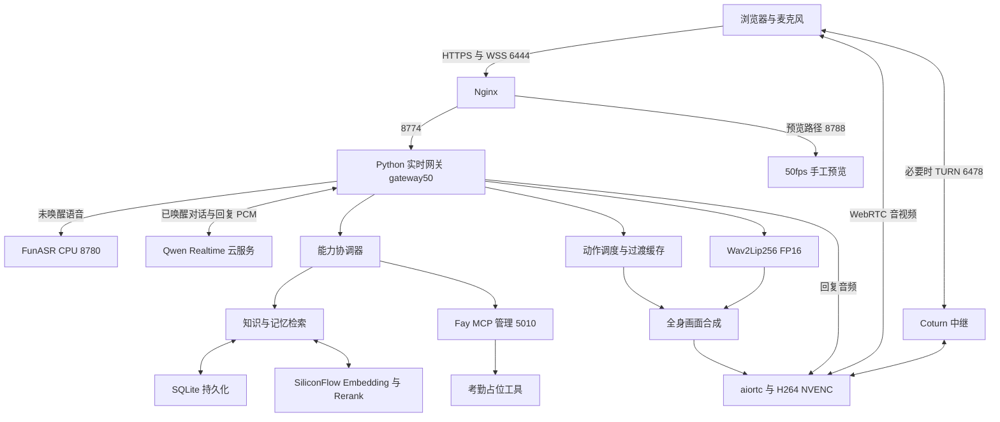

# 小霖数字人技术与部署交接

交接日期为 2026 年 11 月 12 日。服务器状态采集时间为北京时间 11 月 12 日 11 时 18 分，配置补充核验在同次 SSH 会话完成。

本文面向接手开发、算法、运维和联调人员，涵盖当前正式系统、部署依赖、配置入口、素材处理、恢复方式和后续建设路线。当前项目工作目录为 `D:\Code\3D数字人`。

运行事实来自服务器只读采集，历史测试结论来自项目内保留的结果文件。本文中的运维命令供交接后操作参考，本次编写文档期间仅执行了只读检查。模型、云平台和网络产品的最新版本选型未在本次任务中进行外部检索。

## 1. 接手时先掌握的状态

| 项目 | 当前情况 |
| --- | --- |
| 正式访问入口 | `https://36.133.88.94:6444/` |
| 数字人形象 | 穿裙子的小霖，真人全身视频素材 |
| 当前技术形态 | 2D 视频数字人，预录身体动作与实时生成的嘴部区域合成 |
| 正式帧率及分辨率 | 50 fps，1080 × 1920 |
| 正式唇动 | Wav2Lip256，FP16 |
| 正式容器 | `xiaolin-formal50-materials` |
| 正式发布目录 | `/opt/xiaolin/releases/formal50-materials-20261111-173737` |
| 正式后端 | `127.0.0.1:8774` |
| 素材版本 | `graded-transitions-v1`，已包含四个动作的调色与过渡 |
| 正式 GPU | GPU1，Tesla T4 |
| 手工预览 | `xiaolin-50fps-preview`，GPU0，后端 `127.0.0.1:8788` |
| 预览入口 | 正式域址下 `/experiments/50fps/`，实时预览路径 `/experiments/50fps/live` |
| 实时对话模型 | `qwen-audio-3.1-realtime-flash` |
| 音色 | `longanqian_v3.1` |
| 唤醒识别 | CPU FunASR / SenseVoiceSmall，唤醒词“小霖小霖” |
| 当前能力开关 | 协调、知识、记忆、动作开启，MCP 关闭，配置修订号 20 |
| 网页访问 | 已取消网页 Basic Auth，当前 Nginx 配置仅发现 6444 HTTPS 监听 |
| 单会话约束 | 一个网关实例持有一个展示会话 |
| 25 fps 基线 | 已冻结，保留于 `/opt/xiaolin/baselines/formal25-20261111-161511` |

### 1.1 尚需继续处理的事项

- 公网浏览器音视频仍有历史失败记录。Edge 曾短暂显示活动视频，随后反复重连并最终提示音视频连接失败，Firefox 也未取得持续播放验收。此次健康检查未重新进行浏览器长时间会话验证，故保留“未解决”的交接状态。
- 用户认可的 C 方案已经生成挥手、再见、讲解和点头的离线有声对照。正式实时引擎仍使用原有嘴部融合方案，C 方案尚待流式接入与性能验证。
- 考勤 MCP 当前保留的是占位实现。真实考勤系统的鉴权、人员映射、业务回执和幂等处理还需对接。
- 回退到上一版 50 fps 和冻结 25 fps 的脚本已经准备，历史记录仅确认语法检查，实际回退演练尚待执行。
- 当前环境依赖多个发布目录、模型目录和共享数据挂载。完整空机重建尚未演练。

## 2. 总体技术路线

### 2.1 当前采用的方案

当前采用“浏览器薄终端 + 云端实时语音大模型 + T4 唇动渲染 + 预处理动作素材 + WebRTC 推流”的组合。

浏览器负责麦克风采集、设置操作、文本输入、音视频播放和重连。服务器负责唤醒、实时模型连接、工具协调、知识检索、记忆存储、动作调度、嘴部生成、编码和媒体发送。

身体、服装、背景和大部分面部表情来自真实录制素材。Wav2Lip 根据回复语音生成嘴部区域，合成回全身画面。动作之间使用提前构建的过渡帧，运行时读取素材缓存。

仓库同时存在 Unity、UE、Fay、其他数字人实验目录。这些目录具有历史或独立试验用途，当前正式服务的主入口为 `gateway50.py`。



### 2.2 主要技术组件

| 层级 | 技术 | 当前职责 |
| --- | --- | --- |
| 浏览器 | HTML、JavaScript、AudioWorklet、WebSocket、RTCPeerConnection | 页面、麦克风、会话、设置和媒体播放 |
| HTTP 与异步服务 | Python、aiohttp、asyncio、websockets | API、模型事件、会话生命周期和任务协调 |
| 语音交互 | Qwen Realtime | 活跃对话语音理解、文本回复和语音回复 |
| 唤醒 ASR | FunASR、SenseVoiceSmall | 本地 CPU 识别唤醒语音 |
| 唇动 | PyTorch、Wav2Lip256、CUDA FP16 | 根据音频生成 256 尺寸人脸区域中的口型 |
| 图像与素材 | OpenCV、NumPy、DIS 光流、Lab 色彩处理 | 调色、对齐、补帧和动作过渡 |
| 音频特征 | librosa、重采样、Mel 特征 | 将回复音频转换为唇动模型输入 |
| 音视频传输 | aiortc、aioice、PyAV、H.264、NVENC、Coturn | 编码、时钟、ICE 协商和中继 |
| 检索与记忆 | SQLite WAL、Embedding、Rerank | 文档、记忆、检索排序和工具执行审计 |
| 工具管理 | Fay MCP 管理接口、考勤 MCP | 工具发现与调用，当前正式开关关闭 |
| 部署 | Ubuntu、Docker、NVIDIA CDI、Nginx、systemd | 服务隔离、GPU 选择、代理和开机恢复 |

### 2.3 已尝试的其他唇动路线

| 路线 | 已有工作 | 接手时的处理方式 |
| --- | --- | --- |
| Wav2Lip256 FP16 | 当前正式 50 fps 路线，已有素材缓存及服务器内媒体验证 | 作为当前维护主线 |
| MuseTalk 1.5 原版 VAE | 已做 T4 预览与正式页面接入实验，相关旧容器已停止 | 保留模型与记录，切换前重测性能、延迟、画质和公网播放 |
| MuseTalk TAESD 等试验 | 存在独立评估容器与文件 | 根据评估证据决定是否继续 |
| 嘴唇关键点 C 方案 | 现有 Wav2Lip 合成阶段的改进，已有离线对照 | 完成流式生命周期与性能测试后进入候选发布 |
| 3D 数字人 | 仓库有 Unity、UE 等独立工作 | 需要另行组织角色、骨骼、表情、渲染和终端路线 |

50 fps 指当前音视频调度和渲染链路的运行帧率。原始动作是 25 fps，已通过光流预处理到 50 fps。Wav2Lip 的训练参数中存在 25 fps 假设，当前通过适配音频特征索引、推理与媒体时钟实现 50 fps 输出，后续仍应以真实播放和口型效果验收。

## 3. 服务器配置

### 3.1 本次实际读取的硬件与系统

| 项目 | 实测值 |
| --- | --- |
| 主机名 | `ecs-50675667` |
| 公网 IPv4 | `36.133.88.94` |
| 内网 IPv4 | `192.168.0.116` |
| 系统 | Ubuntu 26.04 LTS，x86_64 |
| 内核 | `7.0.0-43-generic` |
| CPU | Intel Xeon Processor (Cascadelake)，16 个逻辑 CPU |
| CPU 拓扑 | 虚拟机报告 2 个 socket，每 socket 4 核，每核 2 线程 |
| 内存 | 130,601,488,384 bytes，约 121.6 GiB |
| 采集时可用内存 | 121,998,139,392 bytes，约 113.6 GiB |
| Swap | 约 4 GiB，采集时使用量为 0 |
| 根文件系统总量 | 1,056,682,733,568 bytes，约 984.1 GiB |
| 根文件系统可用 | 795,430,092,800 bytes，约 740.8 GiB |
| GPU | 2 × Tesla T4，每张 `15360 MiB` 显存 |
| GPU 功耗上限 | 每张 70 W |
| NVIDIA 驱动 | `595.91.07` |
| Docker Engine | `29.1.3` |
| Docker Compose | `2.40.3+ds1-0ubuntu1` |

本地运维目录沿用了 `runtime/server-4t4` 名称，实际本次只发现两张 T4。

### 3.2 GPU 绑定

| GPU | UUID | 当前用途 | 采集时进程显存 |
| --- | --- | --- | --- |
| GPU0 | `GPU-ef5cc59f-01e3-6165-147c-15bcbb737d0f` | `xiaolin-50fps-preview` | 516 MiB |
| GPU1 | `GPU-d83c041f-3543-6c67-faf0-23f3d1910f44` | `xiaolin-formal50-materials` | 518 MiB |

容器使用 NVIDIA CDI 设备名绑定 GPU，例如 `nvidia.com/gpu=GPU-d83c041f-3543-6c67-faf0-23f3d1910f44`。容器内部的 CUDA 索引受可见设备集合影响，定位宿主机显卡应使用 UUID。

上述显存来自空闲状态快照。长时间说话、模型切换、素材预热和 NVENC 编码时的峰值需单独测量。现有一个正式展示会话和一个预览实例，尚未形成多会话容量结论。

### 3.3 容器内关键依赖

| 正式容器组件 | 读取到的版本 |
| --- | --- |
| torch | `2.9.1+cu128` |
| torchvision | `0.24.1+cu128` |
| PyTorch 编译 CUDA | `12.8` |
| cuDNN 返回值 | `91002` |
| NumPy | `1.26.4` |
| aiortc | `1.14.0` |
| aioice | `0.12.0` |
| av / PyAV | `16.1.0` |
| librosa | `0.10.2.post1` |
| numba | `0.61.2` |
| transformers | `4.57.1` |
| soundfile | `0.12.1` |

ASR 容器读取到 FunASR `1.4.16`、CPU 版 torch `2.9.1+cpu` 和 transformers `5.22.1`。正式容器按 `opencv-python` 分发名查询返回空，实际 OpenCV 分发名和 `cv2.__version__` 需在制作完整依赖锁定表时补齐。

历史 `nvidia-smi` 显示的 CUDA 13.2 是驱动可支持的 CUDA 版本信息。当前正式 PyTorch 编译使用 CUDA 12.8，环境恢复应同时核对驱动、镜像和 PyTorch 构建版本。

### 3.4 服务器选型与容量路线

当前服务器可作为同形态环境迁移的配置参考。空机复制时先匹配 NVIDIA 驱动、Docker CDI、容器镜像和模型资产，再按单会话实测确定 CPU、内存、磁盘和带宽预算。

- T4 承担 Wav2Lip 与 H.264 NVENC。ASR 当前运行在 CPU。
- 素材缓存已达约 33 GiB，部署时还需要保留源视频、模型、旧发布目录、冻结基线、输出和构建临时空间。
- 正式编码默认目标码率约 4 Mbps，上限约 6 Mbps。公网带宽预算还应包含音频、协议开销、重传及同时运行的预览。TURN 会增加服务器中继流量。
- 多终端同时独立对话需要会话调度、多渲染器、GPU 配额和媒体带宽设计。当前网关的单展示会话约束需要先改造。
- 磁盘吞吐影响原始帧缓存读取，模型显存占用只覆盖容量分析的一部分。

## 4. 运行服务与启动关系

### 4.1 当前保留的常驻服务

| 容器 | 镜像 | 职责 |
| --- | --- | --- |
| `xiaolin-formal50-materials` | `xiaolin-presenter:20261110-ports` | 正式实时网关、口型、动作、WebRTC |
| `xiaolin-nginx-1` | `nginx:1.28-alpine` | HTTPS、WebSocket 和路径代理 |
| `xiaolin-turn-1` | `xiaolin-turn:20261110-ports` | Coturn 中继 |
| `xiaolin-asr-1` | `xiaolin-asr:20261110-ports` | CPU 唤醒 ASR |
| `xiaolin-fay-1` | `xiaolin-fay:20261110-ports` | MCP 管理入口，旧 Fay 语音链路已停止 |
| `xiaolin-attendance-1` | `xiaolin-fay:20261110-ports` | 考勤占位 MCP 服务 |

正式镜像 ID 为 `sha256:4b0a63ce4474a2cb137d5bd16cea17bb69540d32ce149f200d4282f04d4745cd`。镜像提供基础依赖，正式业务代码还来自宿主机挂载的发布目录。

手工预览容器 `xiaolin-50fps-preview` 当前运行，采用 `restart=no`，未纳入正式启动服务列表。

### 4.2 已退役的主要运行入口

以下容器已经停止，保留历史环境和恢复依据。

- `xiaolin-presenter-1`
- `xiaolin-qwen-realtime-v1`
- `xiaolin-qwen-realtime-v2`
- `xiaolin-qwen-musetalk-v2`
- `xiaolin-musetalk-original`
- `xiaolin-musetalk-https`
- `xiaolin-musetalk-taesd-eval-20261111`
- `xiaolin-bootstrap-1`
- `xiaolin-formal-50fps`

此外还有已退出的评估、导出和校验容器。判断实际服务以容器运行状态、Nginx 上游和 `current-runtime.json` 三者交叉核对。

服务器还存在其他产品相关资源，如历史发现的 `medicare-audit-*`。数字人服务维护以 `xiaolin` 资源为操作范围。

### 4.3 开机启动

`xiaolin.service` 已启用且处于 active，drop-in 为 `/etc/systemd/system/xiaolin.service.d/current-only.conf`，控制入口为 `/opt/xiaolin/deployment/control-current.sh`。

当前启动顺序为 TURN → ASR → Fay → attendance → 正式网关 → Nginx。停止顺序由脚本显式指定。脚本支持 `start`、`stop`、`status`、`logs`。

仓库的旧 `deploy/t4-cloud/compose.yaml` 记录早期服务组合。后续正式 50 fps 容器通过发布脚本建立，整套旧 Compose 启动可能重新拉起已退役服务。日常恢复使用当前控制脚本，空机恢复则按本文挂载和服务清单重新整理部署定义。

## 5. 目录、挂载与持久化

### 5.1 宿主机目录

```text
/opt/xiaolin/
  deployment/
    current-runtime.json
    control-current.sh
    formal50-candidate.json
    material-release.json
    rollback-material-release.py
    rollback-formal25.py
    retired-xiaolin-20261111-155354/
  releases/
    20261110-ports/                     基础发布、Nginx 与共享服务代码
    formal50-20261111-161638/           前一版 50 fps
    formal50-materials-20261111-173737/ 当前正式版本
      avatar-2d/experiments/
      material-cache/
      state/settings.json
      state/capabilities.sqlite3        指向共享业务库的链接
  baselines/
    formal25-20261111-161511/
  shared/
    config/system.conf
    config/turn-secret
    certs/
    assets/avatar-2d/models/
  evaluations/
    presenter-v2-1080/
    musetalk-t4-20261111/
  current -> releases/20261110-ports
```

`/opt/xiaolin/current` 当前指向 `20261110-ports`，主要提供基础代码和依赖路径。正式业务发布目录由 `current-runtime.json` 的 `formal_release` 指定。定位当前正式版本时先读取运行记录与容器挂载。

### 5.2 正式容器挂载

| 宿主机 | 容器路径 | 权限 / 用途 |
| --- | --- | --- |
| `/opt/xiaolin/current` | `/app` | 只读基础代码 |
| 当前正式发布目录 | `/formal` | 可写，正式代码、状态、缓存 |
| `/opt/xiaolin/evaluations/musetalk-t4-20261111/musetalk-eval` | `/muse` | 只读 MuseTalk 资源 |
| `/opt/xiaolin/evaluations/presenter-v2-1080` | `/eval` | 可写，形象、共享运行数据与输出 |
| `/opt/xiaolin/shared/assets/avatar-2d/models` | `/eval/avatar-2d/models` | 只读模型 |
| `/opt/xiaolin/shared/config/system.conf` | `/config/fay-system.conf` | 只读云服务配置 |
| `/opt/xiaolin/shared/config/turn-secret` | `/config/turn-secret` | 只读 TURN 密钥文件 |

`/formal/avatar-2d` 中部分 assets、models、runtime、tools、outputs 路径通过符号链接访问 `/eval`，service 通过链接访问 `/app`。新建容器时需要保留完整挂载关系。

### 5.3 业务状态

- 正式设置文件位于 `/formal/state/settings.json`，由 `QWEN_STATE_DIR` 控制。
- 正式知识与记忆库入口为 `/formal/state/capabilities.sqlite3`，实际目标位于 `/eval/avatar-2d/runtime/qwen-realtime-v2/capabilities.sqlite3`。
- 本次读取到 `documents` 82 行、`effects` 6 行、`audit` 204 行。文档未导出业务内容。
- SQLite 使用 WAL。在线备份应使用 SQLite backup API 或停写后的完整一致性备份，恢复时同时考虑主库与 WAL 状态。
- 设置修订号参与并发和在途任务一致性处理。配置写入使用临时文件与原子替换，接手修改时应延续此行为。

## 6. 后端配置路线

### 6.1 配置的读取层次

1. Docker 容器环境变量决定监听地址、来源校验、状态目录、GPU 运行方式、ICE 范围和编码器。
2. `state/settings.json` 决定当前对话模型与能力开关，覆盖程序初始默认值。
3. `/config/fay-system.conf` 提供实时云模型、Embedding、Rerank 等服务的配置与密钥。
4. `provider.py` 中仍有模型默认值、音色和实时服务 URL 等代码级配置。
5. 素材 profile、缓存计划与模型文件决定人物、动作、裁剪框和过渡路径。
6. Nginx、Coturn、systemd 分别决定公网入口、中继和启动关系。

配置修改前先确认修改层次。代码默认开关与实际保存开关可能不同，例如源码的 MCP 默认可开启，而当前正式保存值为关闭。

### 6.2 当前正式环境变量

```dotenv
QWEN_DEMO_PORT=8774
QWEN_DEMO_ORIGIN=https://36.133.88.94:6444
QWEN_STATE_DIR=/formal/state
FAY_SYSTEM_CONF=/config/fay-system.conf
XIAOLIN_DEPLOYMENT=/app/avatar-2d/service
XIAOLIN_MATERIAL_CACHE=/formal/material-cache
XIAOLIN_TURN_HOST=36.133.88.94
XIAOLIN_TURN_PORT=6478
XIAOLIN_TURN_TRANSPORTS=tcp
XIAOLIN_TURN_SECRET_FILE=/config/turn-secret
XIAOLIN_BIND_IP=192.168.0.116
XIAOLIN_ICE_MIN_PORT=10300
XIAOLIN_ICE_MAX_PORT=10349
XIAOLIN_50_PRECISION=fp16
XIAOLIN_VIDEO_ENCODER=h264_nvenc
OPENBLAS_NUM_THREADS=1
MKL_NUM_THREADS=1
OMP_NUM_THREADS=4
CUDNN_CONV_WSCAP_DBG=256
HF_HUB_OFFLINE=1
MODELSCOPE_OFFLINE=1
```

模型离线标志依赖预先齐备的模型文件。新环境应先完成权重、配置、词表等资产同步，再启用离线运行。

### 6.3 当前设置接口

读取接口为 `GET /api/settings`，保存接口为 `POST /api/settings`。

当前读取结果如下。

```json
{
  "model": "qwen-audio-3.1-realtime-flash",
  "coordinator_enabled": true,
  "mcp_enabled": false,
  "knowledge_enabled": true,
  "memory_enabled": true,
  "gestures_enabled": true,
  "lipsync_backend": "wav2lip",
  "revision": 20
}
```

保存时提交完整业务字段集合，`revision` 由服务维护。当前模型枚举支持 flash 和 plus，唇动枚举支持 `wav2lip`、`musetalk`。切换 MuseTalk 会切换相应引擎和 25 fps 媒体时间间隔，需重新做完整验收。

保存配置时网关会停止当前语音监听，并通知页面 `settings_changed`。唇动后端变化会先尝试加载模型，成功保存后关闭原会话并重新建立媒体。加载失败返回 503，原配置继续生效。

`coordinator_enabled` 是能力总开关，单项有效状态为总开关与单项开关共同计算。

### 6.4 云端模型与音色配置

实时模型适配器位于 `avatar-2d/experiments/qwen-realtime-v2/provider.py`。当前实时 WebSocket 接口使用北京区域已配置的服务地址，路径为 `/api-ws/v1/realtime?model=...`。

云端连接使用 `Authorization: Bearer`，密钥从 `system.conf` 的 `[key]` 节读取 `bailian_tts_api_key`。该字段名称沿用了历史命名，当前由实时对话适配器复用。

会话建立后发送 `session.update`，开启 text 与 audio，输入和输出格式为 PCM，使用 server VAD，阈值 0.5，静音分段时间 500 ms。

音色当前写在 `provider.py` 的 `VOICE` 常量中。调整音色需要检查该常量、模型支持情况和重新建连行为。页面设置目前主要管理模型与能力开关。

### 6.5 Embedding 与 Rerank

| 配置项 | 当前值 |
| --- | --- |
| `embedding_api_model` | `Pro/BAAI/bge-m3` |
| `embedding_base_url` | `https://api.siliconflow.cn/v1` |
| `rerank_api_model` | `Pro/BAAI/bge-reranker-v2-m3` |
| `rerank_base_url` | `https://api.siliconflow.cn/v1` |
| `embedding_api_key` | 已配置，正文只记录存在性 |
| `rerank_api_key` | 已配置，正文只记录存在性 |
| 旧独立 `llm_*` 字段 | 本次读取为空，实时对话使用 Qwen 适配器 |

Embedding 使用 `/embeddings`，Rerank 使用 `/rerank`。现有实现要求所选模型名称以 `Pro/` 开头，这是当前项目实现中的校验条件。

本次未发起收费模型验证请求。密钥存在与模型填写正确分别属于配置层证据，供应商额度、权限和实时可用性需要在后续联调中确认。

### 6.6 凭据交接

凭据应通过受控方式单独交接，文档只记录存放位置和用途。

| 项目 | 存放位置 / 管理点 |
| --- | --- |
| SSH 登录凭据 | 运维负责人单独保管 |
| Qwen、Embedding、Rerank 密钥 | `/opt/xiaolin/shared/config/system.conf` |
| TURN 共享密钥 | `/opt/xiaolin/shared/config/turn-secret` |
| HTTPS 证书与私钥 | `/opt/xiaolin/shared/certs/` |
| 浏览器 CA 信任 | 终端系统或浏览器证书信任存储 |

网页 Basic Auth 已按用户要求取消。云模型调用、SSH、TURN 和 TLS 私钥仍各自使用对应凭据。当前 Origin 约束用于限制请求来源，独立用户身份和权限体系仍需后续建设。

## 7. 前后端接口与会话流程

### 7.1 接口清单

| 方法与路径 | 用途 |
| --- | --- |
| `GET /` | 正式页面 |
| `GET /demo.js` | 浏览器逻辑 |
| `GET /ws` | 实时控制与麦克风二进制数据 |
| `GET /api/health` | 网关、模型、媒体、唤醒与渲染状态 |
| `GET /api/rtc-config` | 浏览器 ICE / TURN 配置 |
| `POST /api/offer` | WebRTC SDP 协商 |
| `GET /api/settings` | 读取模型和能力开关 |
| `POST /api/settings` | 保存完整设置 |
| `GET /api/capabilities` | 当前用户域下知识、记忆及工具概要 |
| `POST /api/knowledge` | 知识入库 |
| `DELETE /api/knowledge/{identifier}` | 删除当前域的知识条目 |
| `POST /api/say`、`POST /api/action` | 当前网关返回 410，保留旧调用迁移提示 |

HTTP 请求带有来源校验，部分业务 API 还需当前 WebSocket 会话授权。客户端通过 `X-Demo-Session` 请求头提交 `ready` 事件返回的 `session_id`。编写自动化客户端时应参照现有验证脚本建立同一会话。

### 7.2 WebSocket 消息

前端发送的文本消息包含 `type` 字段，当前处理 `start`、`listen`、`sleep`、`text`、`interrupt`、`stop`。二进制消息用于麦克风 PCM。

连接建立后服务发送 `ready`，包含 `session_id`、模型、音色和当前设置。随后页面使用该会话进行 SDP 协商与业务调用。

`scope` 参数限制为 1～48 位字母、数字、下划线和连字符。当前身份由代理头 `X-Xiaolin-User` 或默认身份派生，再与 scope 组合形成业务数据域。匿名页面下默认身份会被复用，多用户隔离需要额外设计。

网关只维护一个 owner。已有展示会话时可能返回 409。带 `takeover=1` 的同源连接可接管旧会话。浏览器关闭、连接失败、主动停止、模型切换和接管均需完成资源清理。

### 7.3 麦克风与唤醒

1. 浏览器通过 AudioWorklet 读取麦克风，重采样为 16 kHz、单声道、16 bit PCM。
2. 每 1600 个采样形成一个发送块，约 100 ms。
3. 未唤醒时服务器积累语音片段，RMS 门限约 0.008，静音约 0.6 秒触发片段结束，最长片段约 12 秒。
4. 片段交给本机 SenseVoiceSmall，匹配句首“小霖小霖”及有限同音形式。
5. 唤醒后进入实时对话，云端进行 server VAD。
6. 约 60 秒无活动后返回待唤醒状态。

唤醒前的识别链路在服务器本地处理。已唤醒的对话语音会发送到云端 Qwen，知识检索还会调用配置的外部 Embedding 与 Rerank 服务。

ASR 服务限制输入约 4 MiB，支持的音频时长上限为 30 秒，解码后使用 16 kHz 单声道。当前健康结果 `state=ready`、`device=cpu`。

### 7.4 回复语音到视频

1. Qwen 返回文本事件及 24 kHz PCM 回复音频。
2. 网关保持重采样状态，将 24 kHz 单声道 16 bit 音频转换为 16 kHz。
3. 音频媒体帧以 20 ms 为单位，每帧 320 个采样。
4. 音频特征使用 80 个 Mel 频带和长度 16 的 Mel 窗口，50 fps 视频按 `80 / 50` 的索引比例取特征。
5. Wav2Lip 使用 FP16，当前推理批次配置以现有引擎为准，已有实现使用 batch 4。
6. 输出人脸区域合成到 1080 × 1920 动作帧，再通过 NVENC 编码和 WebRTC 发送。

中断时必须同步清理云端响应、排队音频、待渲染音频、动作请求和旧任务事件。后续修改应沿用会话、轮次及配置修订号的过期结果隔离逻辑。

## 8. 知识库、长期记忆与 MCP

### 8.1 知识与记忆路线

能力代码位于 `capabilities.py`。SQLite 同时保存文档、向量与业务元数据，知识和记忆按类型、用户域、模型名和向量维度筛选。

当前检索过程从对应类型和用户域中取最近最多 1000 条候选，计算余弦相似度，门限约 0.3，保留前 20 条，再由 Rerank 返回最多 4 条，分数门限约 0.15。实现还校验返回向量、重排索引及重复索引。

更换 Embedding 模型或向量维度时需要制定重建策略，已有向量记录仍携带原模型和维度信息。新增知识会触发外部 Embedding 调用，应先准备正确的配置和模型访问权限。

协调工具参数包含考勤请求、知识查询、记忆查询和动作。普通聊天可以直接生成回复，业务指令按能力开关执行。工具结果作为参考内容传入后续生成，提示词要求如实说明检索结果和业务执行情况。

### 8.2 幂等与审计

`effects` 表记录副作用执行状态，`audit` 表记录调用审计。记忆写入使用用户、轮次和类型等信息控制重复写入，副作用通过唯一标识和 `INSERT OR IGNORE` 认领。

已开始但结果未知的副作用需要保留未知状态，接入真实考勤后还需结合业务方提供的幂等键和状态查询接口处理重试。

### 8.3 MCP 当前边界

Fay 管理端监听 `127.0.0.1:5010`。现有路由读取 `/api/mcp/servers/online/tools`，再调用 `/api/mcp/servers/{server_id}/call`，目标工具名为 `attendance_check_in`。

本次清洗后的在线工具名称清单为空，当前正式 MCP 开关为 false。接手时需要核实管理端原始返回结构、工具注册与 online 状态，完成实际工具发现和调用测试。

考勤占位实现可返回演示成功文本。真实落地需要完成以下接口工作。

- 终端、人员身份、工号和考勤主体映射。
- 业务 API 地址、鉴权方式和权限。
- 班次、时间、地点与重复签到规则。
- 请求流水号、幂等处理、超时后查询。
- 真实业务成功与失败回执。
- 审计日志、数据脱敏和可追溯性。

## 9. 人物素材与动作处理路线

### 9.1 原始素材

| 动作 ID | 内容 | 原始 25 fps 帧数 | 时长 | 50 fps 主体帧数 |
| --- | --- | --- | --- | --- |
| `idle` | 待机 | 750 | 30 秒 | 1500 |
| `welcome-wave` | 欢迎挥手 | 175 | 7 秒 | 350 |
| `goodbye-wave` | 再见挥手 | 175 | 7 秒 | 350 |
| `explain-open-palms` | 双掌讲解 | 175 | 7 秒 | 350 |
| `acknowledge-nod` | 点头确认 | 100 | 4 秒 | 200 |

人物 profile 位于 `avatar-2d/assets/presenter-v2-1080/profile.json`。人脸检测、裁剪坐标和 256 尺寸人脸序列属于素材构建的一部分，新增素材需要同步更新全身帧、人脸帧和坐标。

Wav2Lip 主权重的代码读取路径为 `avatar-2d/models/wav2lip256.pth`，正式容器通过 `/eval/avatar-2d/models` 的共享模型挂载访问。接手恢复时还需要完整的人脸检测器和 ASR 模型目录，模型文件清单与哈希应在空机重建演练前补齐。

### 9.2 已部署的调色与空间对齐

先以待机参考帧对齐人物位置与大小，使用每段固定的缩放和平移参数，保持整段空间稳定。

调色采用 Lab 色彩空间，以待机面颊作为颜色参考，为每段动作计算固定修正。肤色区域通过软遮罩和边缘羽化过渡，处理面部、手臂和腿部，整段使用一致参数。

25 fps 调色母版保留于 `avatar-2d/assets/presenter-v2-1080/color-matched-20261111/`。原始文件仍作为追溯和重新处理依据。

### 9.3 25 fps 到 50 fps

当前素材预处理使用双向 DIS 光流，在约 540 × 960 的尺度计算运动，再映射到全分辨率生成中间帧。输出保持原时长，最后一帧按约 20 ms 保持。

全部主体素材合计 2750 帧。光流对手指、衣裙边缘、遮挡与快速挥手可能产生局部形变，新动作仍需逐段看画面。

### 9.4 动作与待机过渡

当前过渡库包含 274 段桥接，每段 15 帧，对应 0.3 秒，合计 4110 帧。缓存同时保存全身帧、人脸帧、裁剪坐标和过渡计划。

待机拆分为约 0～10.8 秒、10.8～22 秒、22～30 秒三个区段。动作入口候选包括每 25 帧的锚点、区段端点和已选位置。调度器结合人脸、躯干、手部图像及运动描述，在后续最多约 29 帧内选择切换位置。

请求动作后最多等待约 0.6 秒，再经过 0.3 秒过渡进入动作。动作主体完整播放，结束后经过过渡返回匹配的待机位置。待机区段之间也有桥接。

该调度使用图像和运动描述，后续如需更强的姿态约束，可以引入骨骼关键点并重新构建候选评分。

队列保留一个待执行动作，同一活动动作的重复请求会被忽略，新的不同动作可覆盖待执行项。取消会清除等待动作，当前身体动作按现有调度完成回程。

### 9.5 缓存与修改规则

当前 `material-cache` 占用约 33 GiB，包含大量原始帧 memmap。运行时避免重复执行光流计算，主要读取已构建缓存。

核心文件包括 `motion_transitions.py`、`idle_scheduler.py`、`engine50.py`、`render50.py`，构建脚本位于 `deploy/t4-cloud/`。

新增或更换动作时按源素材 → 固定空间对齐 → 调色 → 50 fps → 人脸与坐标 → 过渡库 → 调度验证 → 有声对照的顺序处理。缓存应使用新的发布目录并记录素材版本，以便回退和比较。

## 10. 嘴部微笑冲突与 C 方案

### 10.1 问题来源

挥手素材原有微笑与 Wav2Lip 预测的说话口型存在差异。传统较大范围下半脸融合会改变嘴角、面颊和微笑形态，音频包间隙或句尾切回原素材时还可能出现表情跳变。

### 10.2 已有对照

| 方案 | 实现内容 | 当前状态 |
| --- | --- | --- |
| A | 原有按音频块控制口型状态，较大范围下半脸融合 | 正式基线行为 |
| B | 整句保持口型状态，句尾平滑恢复微笑 | 离线对照完成 |
| C | B 的整句控制，加源画面与预测画面的嘴唇关键点联合遮罩 | 用户倾向 C，四个动作离线结果已生成 |

整句方案使用约 10 帧提前进入、6 帧保持、12 帧恢复，分别约 0.20、0.12、0.24 秒。

C 方案使用 MediaPipe Face Landmarker，取源画面与预测画面的嘴唇关键点联合凸包，使用约 `0.55 × 当前 + 0.45 × 上一帧` 的 EMA，并包含当前原始关键点防止跟踪滞后，再进行 13 × 13 膨胀与 Gaussian sigma 4 羽化。

离线依赖位于 `/formal/smile-review-20261111/libs`，MediaPipe 版本 `0.10.32`，模型为 `face_landmarker.task`，CPU XNNPACK。正式进程尚未依赖该离线包目录。

### 10.3 对照素材与证据

所有对照使用同一段“你好，欢迎你！很高兴为你服务。”的回复音频，约 3.04 秒、16 kHz 单声道。首次获取后复用 PCM，便于比较嘴部合成。

- 欢迎动作 A/B/C 位于 `avatar-2d/outputs/smile-speech-review-20261111/`，单段约 11.68 秒、584 帧。
- 再见、讲解、点头 A/C 位于 `avatar-2d/outputs/smile-other-actions-20261111/`，合并约 32.04 秒、1602 帧。
- 后三个动作合计处理 537 帧嘴部预测，关键点失败与回退计数均为 0。
- 脚本位于 `avatar-2d/experiments/presenter-50fps/review_smile_speech.py`。

连续 PCM 的离线对照覆盖了画面和句尾恢复，流式网络间隙还需专项验证。

### 10.4 正式接入需要完成的工作

1. 使用回复轮次、音频开始、结束和取消事件维护整句状态，处理临时无音频包、续包和中断。
2. 处理旧轮次音频、工具等待、模型错误、用户打断和配置切换，防止旧结果回写。
3. 提前计算素材源画面的嘴唇关键点，减少在线每帧检测次数。
4. 测量预测画面关键点检测、遮罩构建和图像融合的耗时及 GPU / CPU 占用。
5. 增加关键点失败时的稳定回退，记录回退次数并保留诊断帧。
6. 对四个动作、长句、停顿、短词、连续回复进行 50 fps 媒体与主观画质验证。
7. 在候选实例完成浏览器验收，再切换正式上游。

## 11. 网络、HTTPS 与 WebRTC

### 11.1 端口关系

| 端口 | 绑定 / 协议 | 当前用途 |
| --- | --- | --- |
| 6444 | 公网 TCP / HTTPS | 正式页面、API、WSS、预览路径 |
| 6478 | TCP 和 UDP | Coturn 监听，正式配置下发 TCP transport |
| 10000～10049 | UDP | Coturn relay 分配范围 |
| 10300～10349 | UDP | 正式 aiortc ICE 端口范围 |
| 10200～10249 | UDP | 手工预览 ICE 端口范围 |
| 8774 | `127.0.0.1` TCP | 当前正式后端 |
| 8788 | `127.0.0.1` TCP | 手工预览后端 |
| 8780 | `127.0.0.1` TCP | CPU ASR |
| 5010 | `127.0.0.1` TCP | Fay MCP 管理 |
| 6025 | 公网 SSH 映射 | 经端口映射到主机 SSH 22 |
| 22 | 主机 SSH 实际监听 | sshd，公网原 22 的入站限制需结合云平台核对 |

历史 6443、6445 和旧后端 8771、8772、8773 在旧资料中出现。本次 Nginx 路由和监听采集显示正式入口为 6444 → 8774。

### 11.2 Nginx

实际配置文件为 `/opt/xiaolin/releases/20261110-ports/deployment/nginx.conf`，容器内挂载到 `/etc/nginx/nginx.conf`。

- 监听 `6444 ssl`，server_name 为公网 IP。
- `/experiments/50fps/` 转发到 `http://127.0.0.1:8788/`。
- `/` 转发到 `http://127.0.0.1:8774`。
- 证书路径为容器内 `/certs/server.crt` 与 `/certs/server.key`。
- WebSocket 需要保留 Upgrade、Connection 和足够的代理超时配置，修改前对照现有完整文件。

证书信任应在目标终端完成安装与校验。浏览器麦克风需要安全上下文，HTTPS 可达、WebSocket 成功、WebRTC 媒体成功分别检查。

### 11.3 Coturn 与公网映射

当前关键配置如下，密钥通过文件提供。

```ini
listening-port=6478
listening-ip=0.0.0.0
relay-ip=192.168.0.116
external-ip=36.133.88.94/192.168.0.116
min-port=10000
max-port=10049
realm=xiaolin
fingerprint
use-auth-secret
no-cli
no-multicast-peers
```

使用公网 / 私网映射时，relay 地址、external-ip、云 NAT 和安全组必须相互匹配。`/api/rtc-config` 动态提供 ICE server 信息，诊断时按临时凭据处理其响应。

浏览器曾采用首次 `all`、重试转 `relay` 的 ICE 策略。Firefox 曾有额外 UDP 候选尝试，Edge 曾优先 TURN TCP。实际客户端行为以当前下发的 `demo.js` 与选中的 candidate pair 为准。

### 11.4 云安全组与主机防火墙

历史用户在 2026 年 11 月 10 日反馈已放行来源 `120.195.55.128/28` 的 TCP / UDP `6025～10999`。本次 SSH 读取无法核实云控制台规则，迁移或现场排障应重新核对来源地址、目标端口和 NAT。

对外访问涉及 HTTPS、TURN 控制连接、TURN relay 和可能的直连媒体端口。SSH 6025 由 `xiaolin-ssh-portmap.service` 管理到 22 的映射，因此 `ss` 可能只显示 sshd 监听 22。

SSH 主机公钥指纹为 `SHA256:osgVW3L3qQHK12d4uNtYayKuBQ4rRtsA0t48wB79EHM`，接手时通过受信渠道核对。客户端连接示例如下。

```powershell
ssh -p 6025 root@36.133.88.94
```

## 12. 编码与性能配置

当前正式 `encoder50.py` 使用 `h264_nvenc`，目标码率 4,000,000 bps，上限 6,000,000 bps。输出 `yuv420p`、H.264 Baseline、level 4.2，编码帧率 50，时间基 1/90000。

NVENC 设置包含低延迟调优、CBR、禁用 B 帧和前向预读。现有适配器在进程内配置 aiortc 的 H.264 编码器。

本地工作区同名 `encoder50.py` 仍存在 8 / 12 Mbps 默认值，已经观察到与服务器正式文件不同。后续同步应保留正式 4 / 6 Mbps 配置，或明确记录新码率的测试依据。

性能测量需要同时记录渲染 fps、接收 fps、最大帧间隔、音频队列长度、推理耗时、编码耗时、CPU、GPU、显存和网络吞吐。缓存预热前后、持续说话和动作过渡应分别覆盖。

## 13. 部署与版本发布

### 13.1 当前部署入口

仓库 `deploy/t4-cloud/` 下保留以下素材发布脚本。

| 文件 | 用途 |
| --- | --- |
| `prepare-material-release.py` | 从前一正式版创建新素材发布目录，保留旧配置与容器信息 |
| `build-material-cache.py` | 构建调色、50 fps 与过渡缓存 |
| `start-material-build.py` | 启动独立构建容器 |
| `patch-material-engine.py` | 为素材版本应用引擎适配 |
| `start-material-candidate.py` | 按挂载、环境和指定 GPU 启动候选容器 |
| `validate-material-release.py` | 验证媒体和动作 |
| `activate-material-release.py` | 切换 Nginx 上游、启动清单与版本记录 |
| `audit-material-release.py` | 发布后状态审计 |
| `rollback-material-release.py` | 回到前一 50 fps 发布 |
| `rollback25-materials.py` | 当前素材发布对应的 25 fps 回退实现 |

这些脚本含固定路径、固定容器名、前一上游端口及断言，属于已完成发布的实现记录。下一次发布应建立新版本标识并检查前置状态，避免直接复用固定命名导致冲突。

### 13.2 后续发布步骤

1. 读取 `current-runtime.json`、正式健康、容器挂载、设置和 Nginx 上游，形成发布前快照。
2. 备份共享配置、证书、业务数据库、发布脚本和当前代码，记录镜像 ID、模型清单和缓存版本。
3. 在新的 `/opt/xiaolin/releases/<版本>/` 准备代码与素材，保持共享业务数据指向正确。
4. 需要新依赖时制作候选镜像，锁定版本并验证 CUDA、NVENC、ASR 和模型加载。
5. 使用独立容器名、回环端口和 ICE 端口范围启动候选，确认 GPU 绑定与资源预算。
6. 完成文本、麦克风、唤醒、中断、知识、动作、50 fps、连续音视频与目标浏览器测试。
7. 通过 Nginx 上游切换启用候选，同步更新 `control-current.sh`、运行记录和 restart 策略。
8. 正式上游确认后停止旧实例，保留旧发布、镜像和回退路径。
9. 核对 systemd、手工预览和其他产品服务状态，保存发布审计。

### 13.3 新服务器恢复路线

先部署 Ubuntu、NVIDIA 驱动、Docker 和 NVIDIA CDI，验证 GPU UUID 与容器可见性，再导入固定镜像。复制 `/opt/xiaolin` 的发布、共享配置、证书、模型、形象素材和数据库，保留符号链接及权限。

依次恢复 CPU ASR、TURN、MCP 依赖、正式网关和 Nginx，最后配置 systemd 与 SSH 端口映射。公网地址或内网地址变化时同步修改 Origin、TURN host、external-ip、bind IP、证书和云安全组。

目前尚缺一次完整空机恢复演练，以及根据当前正式状态统一生成的部署清单。应在演练后补充镜像归档、模型哈希、Python / FFmpeg 完整依赖和可重复构建命令。

## 14. 常用运维命令

以下命令在 Linux 服务器执行。

### 14.1 只读查看

```bash
/opt/xiaolin/deployment/control-current.sh status
systemctl status xiaolin.service --no-pager
systemctl status xiaolin-ssh-portmap.service --no-pager
cat /opt/xiaolin/deployment/current-runtime.json
curl -fsS http://127.0.0.1:8774/api/health
curl -fsS http://127.0.0.1:8780/health
docker logs --tail 200 xiaolin-formal50-materials
docker logs --tail 100 xiaolin-nginx-1
docker logs --tail 100 xiaolin-turn-1
nvidia-smi
df -h /opt/xiaolin
free -h
ss -lntup
```

`/api/health` 的 `provider_connected=false`、`rtc_state=absent` 在无展示会话时符合空闲状态。诊断活动会话时再看 `rtc_state`、`ice_state`、`render_error`、`audio_queue`、`mic_bytes` 和渲染计数。

### 14.2 启动、停止与重启

这些命令会影响正式服务与用户会话，应在实际维护时执行。

```bash
/opt/xiaolin/deployment/control-current.sh start
/opt/xiaolin/deployment/control-current.sh stop
systemctl restart xiaolin.service
```

手工预览需要单独管理。

```bash
docker start xiaolin-50fps-preview
docker stop -t 45 xiaolin-50fps-preview
```

### 14.3 Nginx 配置检查与重载

```bash
docker exec xiaolin-nginx-1 nginx -t
docker exec xiaolin-nginx-1 nginx -s reload
```

发布或重载后同时确认正式页面、WebSocket、媒体与预览路径。

## 15. 冻结基线、备份与回退

### 15.1 冻结 25 fps 基线

基线路径为 `/opt/xiaolin/baselines/formal25-20261111-161511`，保留当时的代码、配置、镜像标识和数据库快照。

| 项目 | 值 |
| --- | --- |
| 镜像标签 | `xiaolin-formal25-baseline:20261111-161511` |
| `code.tar.gz` SHA-256 | `710b5a3c14c11dfedc7ab0eb64f545b1b8a06d35a35b779caacd39980f623494` |
| 当时容器 | `xiaolin-qwen-musetalk-v2` |
| 当时后端 | `127.0.0.1:8772` |

模型权重和完整素材缓存仍依赖原有路径，基线中保留引用。迁移备份应一并复制这些被引用资产。

### 15.2 前一版 50 fps

前一版发布为 `/opt/xiaolin/releases/formal50-20261111-161638`，容器 `xiaolin-formal-50fps`，后端 8773。该版本先于四动作调色与桥接素材发布。

### 15.3 回退命令

回到前一 50 fps 的入口如下。

```bash
python3 /opt/xiaolin/deployment/rollback-material-release.py
```

回到冻结 25 fps 的入口如下。

```bash
python3 /opt/xiaolin/deployment/rollback-formal25.py
```

以上脚本将改变正式路由、运行清单与容器状态。既有记录仅确认语法检查，尚未执行实际回退演练。执行前应核对脚本中的发布记录、旧容器、旧端口、Nginx 备份及所需模型路径。

回退设计保留当前共享知识和记忆数据。历史数据库快照用于灾难恢复时，应先判断新增业务数据的保留方式。

### 15.4 备份范围

- 正式与前一发布代码、Nginx、TURN、systemd、端口映射及运行记录。
- settings、SQLite 一致性备份、MCP 注册配置。
- 模型权重、检测器、形象 profile、源视频、调色母版、缓存构建配置。
- 可重建缓存，或在恢复时长要求较高时直接保留缓存。
- 运行镜像的归档、镜像 ID、依赖版本和构建来源。
- 证书、私钥和供应商凭据，单独受控备份。
- 已完成测试的输出、结果 JSON 与必要日志。

## 16. 已有验证与验收差距

### 16.1 正式素材服务器内验证

`runtime/server-4t4/delivery/material-validation.json` 记录如下。

| 指标 | 已保存结果 |
| --- | --- |
| 测试时长 | 约 60.085 秒 |
| 接收视频帧 | 3004 |
| 全窗口帧率 | 约 49.9956 fps |
| 接收帧率 | 约 50.0037 fps |
| 最大帧间隔 | 约 0.2756 秒 |
| 分辨率 | 1080 × 1920 |
| 精度 | FP16 |
| 四个动作 | 各完成至少一次 |
| 动作主体帧 | 1250 |
| 过渡帧 | 150，包含待机衔接 |
| 结束音频队列 | 0 |
| 渲染异常 | null |

调度器还保留了 6000 个入口位置的确定性检查。现有唤醒初始化、中断等自动化记录可供回归参考。

### 16.2 公网浏览器

`runtime/server-4t4/delivery/material-browser-validation.json` 状态为 `FAILED`。历史 Edge 会话曾成功建立页面、WebSocket 和文本回复，活动视频也曾短暂出现，之后发生媒体断连与重试耗尽。

Firefox 曾能看到旧入口的静态人物图，后续确认未形成持续活动画面与语音播放验收。已有 TURN 地址映射、协议和客户端兼容修改仍未证明问题全部解决。

后续应保存浏览器版本、网络出口、selected candidate pair、ICE 状态变化、bytes / frames 计数、丢包、RTT、NACK / PLI、服务端包收发和同步时间线，再定位具体失败阶段。

### 16.3 下一轮验收内容

- Edge 与 Firefox 在目标终端持续播放活动画面和回复音频。
- 物理麦克风唤醒、连续对话、现场扬声器回声和打断。
- 长句、停顿、连续轮次、60 秒超时、网络波动后的恢复。
- 四个动作的肤色、空间对齐、出入场过渡与说话嘴部效果。
- 50 fps 实际接收、峰值帧间隔和口型同步。
- 开关保存、模型切换、接管、断线重连和旧事件清理。
- 知识入库检索、记忆命中和真实工具执行。
- 服务重启、主机重启、候选回退与数据持续性。

## 17. 常见问题定位路线

### 17.1 页面打开但音视频连接失败

按 HTTPS → WSS → 会话归属 → SDP → ICE → DTLS / RTP → 解码播放的顺序核对。

1. 检查证书信任、Origin 和 Nginx 路由，确认请求进入 8774。
2. 检查 WebSocket `ready` 与 session_id，确认是否已有 owner 导致 409。
3. 检查 `/api/rtc-config`、`/api/offer` 响应与客户端取消情况。499 表示代理观察到客户端结束请求，需要结合会话时间线继续判断。
4. 读取浏览器选中的 host / srflx / relay candidate pair 及 transport。
5. 核对 TURN 动态凭据、时间、external-ip、relay IP、分配端口与云安全组。
6. 检查 10300～10349 和 10000～10049 的实际包收发。
7. ICE connected 后再检查 RTP 字节、视频帧增长、H.264 profile 和播放策略。

当前根因尚未最终确认。重复调整 TURN 参数后仍需以同一浏览器会话的抓包和统计证据核对。

### 17.2 有文本回复但嘴部或音频停住

同时观察 provider 音频事件、PCM 重采样、音频队列、渲染异常和 WebRTC RTP 计数。检查是否发生用户打断、配置修订、轮次替换或会话接管，并确认排队数据对应当前轮次。

### 17.3 GPU 使用异常

通过 GPU UUID、进程 PID 与容器交叉定位。确认旧评估容器是否误启动，观察持续说话时的利用率、显存与编码占用。当前 ASR 是 CPU 路线，正式空闲状态低 GPU 利用率具有合理性。

### 17.4 素材肤色或动作跳变

先确认 `material_version=graded-transitions-v1` 与缓存路径，再核对母版、色彩转换、全身与人脸索引、裁剪坐标及 bridge 计划。区分全身位置跳变、肤色差异、光流形变与嘴部遮罩边缘，各自定位处理阶段。

### 17.5 检索没有结果

核对 coordinator 与知识 / 记忆开关、用户域、模型名、向量维度和数据库行数。再检查供应商状态、Embedding 向量返回、相似度门限与 Rerank 分数。当前配置有密钥存在性证据，仍需真实接口调用证据。

### 17.6 重新启动后旧服务出现

检查 systemd drop-in、`control-current.sh`、Docker restart 策略和实际执行的 Compose 文件。当前常驻清单以六个保留容器为准，手工预览单独处理。

## 18. 后续需要推进的技术路线

### 18.1 第一阶段，稳定当前正式链路

目标是让现场 Edge、Firefox 和实际麦克风环境持续工作。

- 形成一次端到端 ICE / RTP 故障时间线，解决公网连接与断线恢复。
- 统一当前代码、环境、Nginx、TURN 与启动清单的版本来源。
- 增加可定位会话、轮次、配置修订和媒体状态的结构化日志。
- 完成正式服务重启、回退与空机恢复演练。

### 18.2 第二阶段，正式化 C 方案

沿用现有 Wav2Lip 路线接入整句口型保持、平滑恢复和嘴唇关键点遮罩。先减少重复检测成本，再覆盖流式间隙、取消、关键点失败和所有动作。以持续 50 fps、延迟、嘴角自然度和口型同步共同验收。

### 18.3 第三阶段，业务能力落地

补齐真实考勤、人员身份、知识管理、记忆保留规则、供应商失败回退和可审计回执。将模型、音色、端点与能力配置逐步统一到可验证的配置管理中。

### 18.4 第四阶段，多终端与容量

引入会话池、渲染进程隔离、GPU 调度、端口池、带宽配额和会话级监控。对每张 T4 的稳定并发做实际压测，再决定扩容方式。

### 18.5 长期形象路线

继续使用真人 2D 素材时，重点投入素材录制规范、动作库、表情一致性、嘴部合成和更自然的过渡。

若需要任意视角、自由动作、全身交互和可编辑表情，需要建设 3D 角色与骨骼、BlendShape、动作系统、实时渲染和终端性能路线。现有业务协调、知识、记忆与语音接口可以作为接口复用的起点，渲染侧需要单独验证。

## 19. 接手团队需要的技术能力

| 能力方向 | 需要掌握的具体内容 | 对应工作 |
| --- | --- | --- |
| Python 后端 | asyncio、aiohttp、WebSocket、取消、并发与幂等 | 网关、工具协调、流式状态 |
| 浏览器音视频 | AudioWorklet、PCM、RTCPeerConnection、自动播放与设备权限 | 终端、麦克风、浏览器兼容 |
| WebRTC 网络 | SDP、ICE、STUN、TURN、DTLS / SRTP、NAT、抓包 | 公网连接、丢包、断线定位 |
| 深度学习推理 | PyTorch、CUDA、FP16、batch、显存与性能分析 | Wav2Lip、模型切换、容量 |
| 图像与视频 | OpenCV、FFmpeg、光流、颜色空间、遮罩与关键点 | 素材、过渡、C 方案 |
| 编解码 | H.264、NVENC、PyAV、PTS、时间基和音画同步 | 50 fps 编码与媒体稳定 |
| Linux 运维 | Docker、CDI、Nginx、systemd、TLS、权限和备份 | 部署、恢复与服务维护 |
| 数据与 RAG | SQLite WAL、向量检索、Embedding、Rerank、用户域 | 知识、记忆、一致性 |
| 工具与业务联调 | MCP、鉴权、幂等、回执、考勤接口 | 业务动作落地 |
| 测试与视听验收 | 真实终端、音画统计、人工口型和肤色评估 | 回归、发布和现场确认 |

实际人员可兼任多个方向。当前优先需要具备 WebRTC 网络诊断能力的工程师，与熟悉 Python 异步流式状态和视频合成的工程师共同接手。

## 20. 文件与证据索引

以下路径相对于项目根目录，文档链接可在本地仓库中打开。

| 文件或目录 | 交接用途 |
| --- | --- |
| [本次服务器脱敏快照](../runtime/server-4t4/delivery/handover-server-20261112.json) | 系统、GPU、容器、挂载、环境、健康与配置存在性 |
| [本次只读采集脚本](../runtime/server-4t4/probe-handover-20261112.sh) | 采集方式和脱敏字段范围 |
| [正式发布运行记录](../runtime/server-4t4/delivery/current-runtime-materials.json) | 材料版本、保留服务和退役服务 |
| [素材部署审计](../runtime/server-4t4/delivery/material-deployment-audit.json) | 已部署版本核对 |
| [服务器内媒体验证](../runtime/server-4t4/delivery/material-validation.json) | 50 fps、动作和媒体指标 |
| [公网浏览器验证](../runtime/server-4t4/delivery/material-browser-validation.json) | 已知失败记录 |
| [发布脚本目录](../deploy/t4-cloud/) | 发布、回退和环境准备 |
| [SSH 6025 说明](../deploy/t4-cloud/SSH-6025.md) | 运维连接与端口映射 |
| [实时模型适配器](../avatar-2d/experiments/qwen-realtime-v2/provider.py) | 模型 URL、音色与凭据读取 |
| [能力协调代码](../avatar-2d/experiments/qwen-realtime-v2/capabilities.py) | 设置、知识、记忆、幂等与工具 |
| [唤醒分段代码](../avatar-2d/experiments/qwen-realtime-v2/wake_gate.py) | 唤醒词、音频分段与超时 |
| [50 fps 实验目录](../avatar-2d/experiments/presenter-50fps/) | 引擎、编码、动作调度与对照 |
| [C 方案离线对照脚本](../avatar-2d/experiments/presenter-50fps/review_smile_speech.py) | 整句口型与关键点遮罩 |
| [欢迎动作有声对照](../avatar-2d/outputs/smile-speech-review-20261111/) | A/B/C 画面比较 |
| [其他动作有声对照](../avatar-2d/outputs/smile-other-actions-20261111/) | 再见、讲解、点头 A/C 比较 |

本地代码与服务器挂载发布已存在局部差异。接手后应从正式发布目录建立受版本控制的可重建源码，并将运行快照、发布脚本和验证结果关联到同一版本。

## 21. 交接完成核对项

- [ ] 接手人员可通过已核对指纹的 SSH 入口登录。
- [ ] 已单独接收云模型密钥、TURN 密钥与证书管理方式。
- [ ] 能说明正式 GPU、容器、发布目录、Nginx 上游及启动入口。
- [ ] 已确认业务数据库真实位置与一致性备份方式。
- [ ] 能复现服务器内 50 fps 与四动作测试。
- [ ] 已复核公网音视频失败，或保存新的持续播放通过记录。
- [ ] 已观看四个动作 C 方案对照，明确实时接入工作范围。
- [ ] 已核实真实 MCP 工具注册和考勤业务接口。
- [ ] 已执行受控的服务恢复、版本回退与数据保留演练。
- [ ] 已补齐空机部署清单、镜像与模型资产归档。

上述项目用于记录交接结果，完成状态由后续实际操作和验收记录填写。
