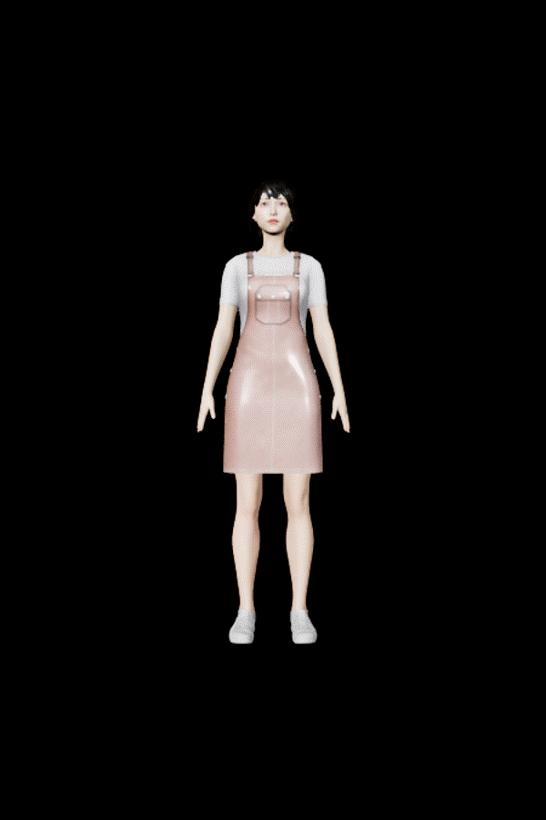
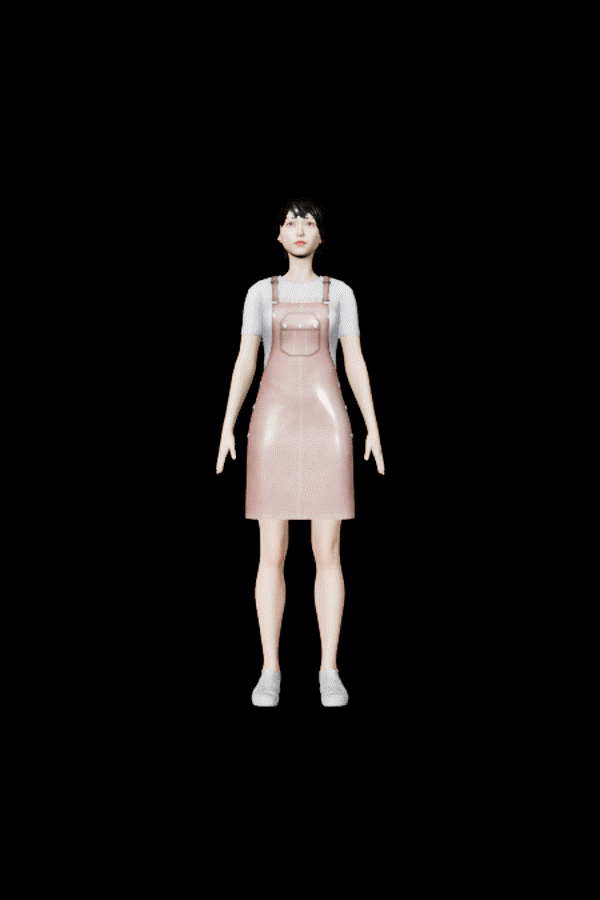
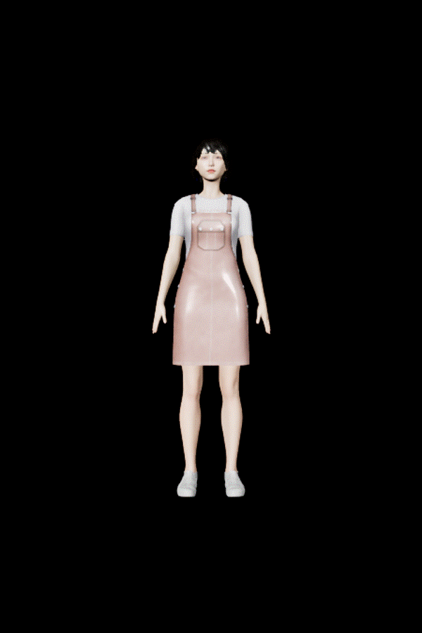
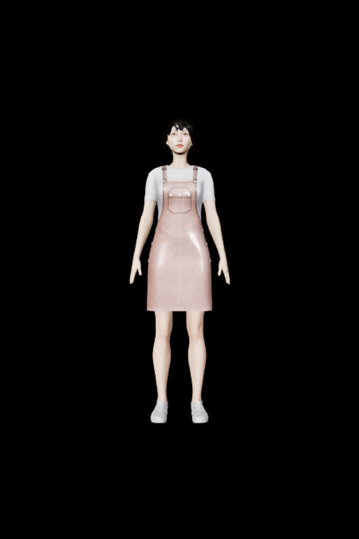
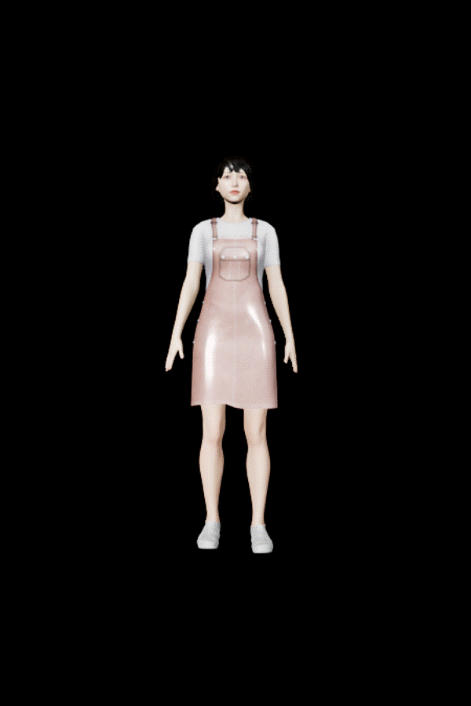
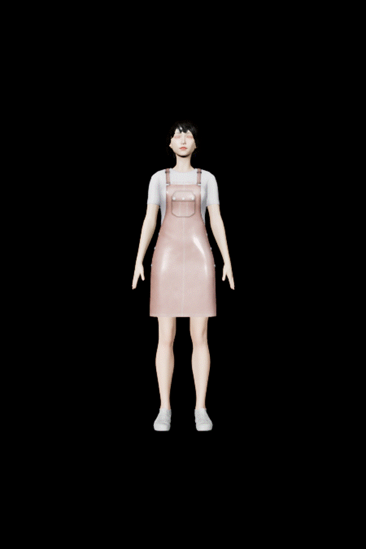

# girl008 动作集与测试

本轮在 UE4.27.2 的本地人物预览中制作动作，源 FBX、材质及 v1 校准保留。启动器默认加载 `assets/girl008-actions-preview-v2.json`。当前为可交互的骨骼关键帧动作集，尚未登记到正式人物目录。

## 查看与操作

双击 `fay-ue4/Start-Girl008-Preview.cmd`。窗口获得焦点后使用键盘上方数字键：

| 按键 | 动作 | 行为 |
|---|---|---|
| 1 | 待机 | 8 秒循环，肩背及头部轻微运动、自动眨眼 |
| 2 | 挥手 | 抬右手、掌心朝向观众、摆手、放回 |
| 3 | 摊手讲解 | 右手掌心向上，配合左臂和头部小幅运动 |
| 4 | 点头 | 点头回应后恢复待机 |
| 5 | 鞠躬 | 上身前倾、低头，再直起 |
| 6 | 指向 | 左臂伸出，食指伸直，其他三指弯曲 |
| 7 | 原地步行 | 短步幅循环，双腿交替抬脚及摆臂；按 1 或 Esc 结束 |
| 8 / 9 | 左转 / 右转 | 绕身体竖轴转约 75 度，再回到正面 |
| 0 | 说话动作 | 无声动作循环；完整语音测试请按空格 |
| - / = | 欢迎 / 告别 | 分别提供入口，当前复用挥手动作 |
| 空格 | 中文音频测试 | 播放/停止本地约 16.43 秒 WAV，并驱动口型和说话动作 |
| Esc | 打断并归位 | 停止音频，闭嘴，恢复待机与自动眨眼 |
| J / B | 面部检查 | 切换张嘴/闭嘴、闭眼/自动眨眼 |
| R | 重载 | 重读当前动作配置，停止旧播放 |
| Alt+F4 | 退出 | 关闭预览窗口 |

动作切换使用约 0.35 秒姿态混合。单次手势结束回到待机；语音播放期间触发手势，则在手势结束后恢复说话动作。脸部口型和眨眼在身体动作之后叠加。12 个动作入口包含欢迎、告别对挥手的复用，共 10 类身体动作/方向。

## 动态预览

这些 GIF 来自 UE 原生逐帧截图，没有替换模型或使用生成式图片。导出按约 10 fps 编码，用于观察动作；不作为帧率或音画同步测试。

| 动作 | 预览 |
|---|---|
| 挥手 |  |
| 讲解 |  |
| 点头 |  |
| 鞠躬 |  |
| 指向 |  |
| 原地步行 |  |
| 左转 |  |
| 右转 |  |

## 验证方式

- Python 回归检查清单、真实骨骼名称、有限数值、骨骼长度、脚趾高度、循环首尾连续及非法关键帧拒绝；包含原有服务测试，Fay/云服务使用模拟对象。
- UE 编辑器模块编译，原生 `HoloKiosk.Motion.TransitionsAndRecovery` 测试使用已导入的真实网格：验证手势中途切换不跳姿态、单次动作恢复待机、说话期间手势结束恢复说话、未知动作不破坏状态、按 60 Hz 模拟 30 秒步行循环，保持有效旋转和骨骼长度、停止后根骨骼无累计位移。
- 实际渲染轮播 12 个入口，逐个保存动作中段、后段、结束后的截图与骨骼数据，并录制连续帧。自动轮播期间忽略交互按键，避免键盘输入重载人物而污染测试。
- 汇总记录为 `girl008-actions-validation-v2.json`。原始渲染证据位于 `ue4/Saved/ActionTests/v2-verified`；引擎自动测试报告位于 `runtime/motion-automation-v2-verified/index.json`。

首轮无界面自动测试断言通过，但进程在 OculusEditor 退出时崩溃。复测仅在命令行加入 `-DisablePlugins=OculusVR`，不修改引擎安装或项目插件设置；最终进程退出状态单独核实。先前的测试记录保留。

启动入口也已实际运行，交互日志确认了“播放本地音频 → 按 2 挥手 → 手势结束恢复说话 → 音频耗尽后待机、嘴部回零”。

## 当前限制

步行是原地动作，没有跨场景移动或寻路；转身是轴向转动后返回，尚无分步转身的脚步编排。欢迎和告别当前使用相同的挥手动作。衣裙依靠现有蒙皮随骨骼变形，尚无布料或头发物理。已检查正面及转身关键姿态，精细手指、袖口褶皱、裙摆及不同视角仍可继续进行美术调整。

当前动作由本地预览及 Blueprint `PlayMotion` 入口触发，尚未绑定真实 Fay 对话意图。正式打包、目标 i5/8GB/GTX1660 性能及现场长时间验收另行进行。
