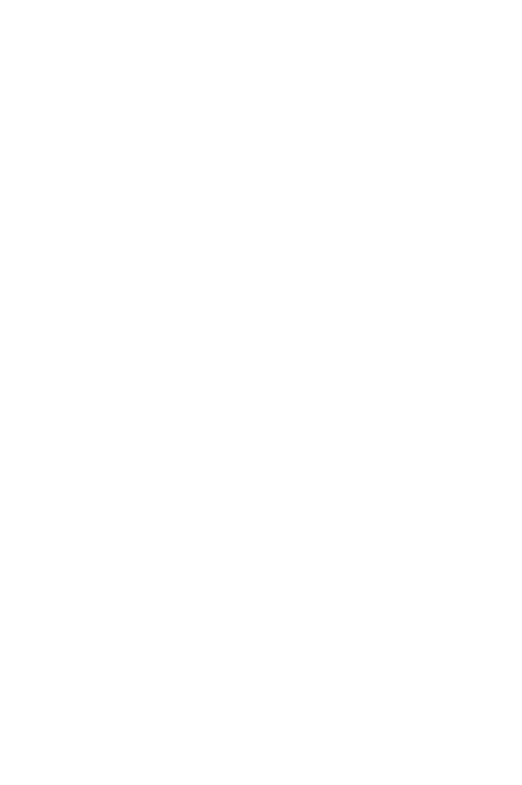

# 无 Maya 的 FBX 人物预览

2026-11-02 更新：已通过 UE4.27.2 编辑器模块编译、真实 FBX 导入和带贴图的黑底全身预览检查。Maya 不是本流程的前置依赖。原模型、旧 Unity 工程及正式人物目录保留。现已加入自然站姿、轻微程序化待机/说话动作、骨骼口型及眨眼，并用本机中文 WAV 完成播放检查。真实 Fay/云语音联调尚未完成。

## 已准备的内容

- `assets/girl008-preview.json`：真实 FBX 路径及 63 个真实存在的骨骼名称，包括一个下颌和每侧 31 个眼睑骨骼。这是保留的零初值基线。v1 校准保存在 `assets/girl008-motion-preview-v1.json`；当前启动器默认使用 `assets/girl008-actions-preview-v2.json` 动作集，详见 [动作说明](ACTIONS.md)。v1 校准版包含嘴唇、牙齿、舌根和眼睑联动，以及 5 个身体骨骼的程序化动作。
- `character_contract.py`：服务和 UE4 Python 共用的清单校验。每个通道允许多个骨骼；拒绝缺少通道、重复骨骼、非有限数字及过大位移/旋转。
- `KioskCharacter`：保留 Morph 模式，新增 bones 模式。复制基础身体姿态后，在局部骨骼空间叠加面部变形；每帧从原姿态重新计算，避免重复叠加产生漂移。音频包络降到零时立即关闭张嘴目标。
- `ue_import_character.py`：预览导入到独立 `/Game/CharacterPreviews/<id>`，输出 `Saved/<id>-preview.json`；不登记 `Content/Data/avatars.json`，也不被正式人物的固定打包目录包含。正式导入仍要求待机和说话动画。
- `Preview-Girl008.ps1`：编译、创建空舞台、导入和本机预览入口；没有安装 UE4.27.2 时会明确失败。

## 本机启动

双击项目中的 `Start-Girl008-Preview.cmd`。本机实际引擎目录是 `D:\Develop\Epic Games\UE_4.27\UE_4.27`，保存于 `runtime/ue-environment.json`。已实测脚本可以编译/检查模块并打开 600×900 人物窗口；原窗口可通过右上角关闭按钮或 Alt+F4 退出。校准版按键 J/B 已有可见的张嘴/闭眼效果；空格播放或停止本机中文校准音频。



以下为在新环境首次导入的操作；本机已导入，不应重复执行首次导入：

在 `fay-ue4` 目录执行，替换为实际的引擎目录：

```powershell
.\Preview-Girl008.ps1 -EngineRoot 'D:\Develop\Epic Games\UE_4.27'
```

编译、导入脚本已在 UE4.27.2 实际执行。首次导入拒绝覆盖已有同名资产。导入成功后再次预览使用 `-SkipImport`；导入失败时检查 UE 日志和残留资源，使用新 id 导入，不自动删除失败产物。修改 id 时需同步脚本中的预览输出文件名。

预览启动后不连接 WebSocket、不启动麦克风、不调用 Fay 或云端接口。窗口启动时显示 `LOCAL PREVIEW` 提示。空格播放/停止约 16.43 秒本地中文音频；J 切换张嘴/归零；B 切换闭眼/自动眨眼；Esc 停止音频并恢复待机及自动眨眼；R 重读预览 JSON；F9 保存 UE 原生截图；Ctrl+Shift+Q 退出。J/B 是切换键，不需要持续按住。

修改 `assets/girl008-motion-preview-v1.json` 后按 R 可重载，不需重新导入网格。无效配置保留原人物并写日志。参数约定：

| 字段 | 含义 |
|---|---|
| `rotation` | `[Pitch, Yaw, Roll]`，角度；相对当前骨骼姿态的局部旋转，单轴上限 ±45 度 |
| `translation` | `[X,Y,Z]`，UE 厘米；局部偏移，单轴上限 ±5 cm |
| `mesh_yaw` / `mesh_scale` | 人物朝向和整体比例 |

从单骨骼、小角度/小位移开始，一次改变一个轴并观察。不要根据 FBX 的 Maya 坐标直接推断 UE 中的正负方向。校准结果应另存新版本。

## 这份人物的特别限制

结构检查表明 `JawJoint_M`、`upperLidMain*`、`lowerLidMain*` 都挂在 `FaceJoint_M` 下。`upperLidBaseJoint_L/R` 不是整片眼睑的共同父骨骼，因此预览改用每个实际眼睑骨骼分别配置。当前依据 UE 实际参考骨架共同驱动下颌、上下唇、下牙和舌根，正面近景已检查；侧脸、不同音素和更大幅度的表情仍需进一步校准。

源 FBX 的 `Take 001` 没有变化曲线。本次保留源文件，在预览中叠加双臂放下的站姿及上身/头部轻微动作；这是程序化预览，不是重定向完成或美术制作的动画资产，正式角色仍要求待机和说话动画。当前不是音素级口型，也没有接入布料、XGen 或头发物理。骨骼模式用隐藏的 SkeletalMesh 计算基础动画，再用 PoseableMesh 显示；源姿态固定 LOD0，以避免面部骨骼被裁掉。这是便于接入与校准的实现，其 CPU/内存开销必须在目标终端测量，不能直接承诺 30 FPS。

源 FBX 的 Arnold 材质通道未自动接入 UE4，现已使用 `ue_materials_girl008.py` 按源文件映射重建预览材质，随后 `ue_bind_materials_girl008.py` 将其绑定到新网格副本。16 个材质、14 个贴图资源均已保存；加载检查可见皮肤、眼睛、头发、上衣、背带裙和鞋。原贴图不改动，UE 贴图运行尺寸上限为 2048。眼角膜/泪线采用简化透明材质，源凹凸图未转换为法线，发片边缘和高光仍需进一步美术调校。

## 当前验证

- 服务与清单回归：27 passed，1 项 Starlette/AnyIO 弃用警告；云服务和 Fay 使用模拟对象。
- 63 个映射骨骼均存在于源 FBX，源文件 SHA-256 与之前检查一致；记录见 `girl008-preview-preflight.json`。
- 沙箱中的异步测试停在 Windows socketpair 初始化，已中止；在本机权限下使用独立临时数据库重新运行通过。
- UE4.27.2 编辑器模块编译通过；VS2019 14.29.30159、Windows SDK 10.0.26100.0、.NET Framework 4.8 SDK。
- UE4 导入成功，63 个映射骨骼全部存在。导入产生末端骨骼绑定姿态、睫毛/眉毛 UV、蒙皮影响数截断提示，不能忽略其对后续动画的影响。
- 开发机已实际显示贴图人物，已校正正面朝向，并保存 UE 原生截图。该检查只证明开发机编辑器预览，不是成品 EXE 或目标终端性能验收。
- 本轮 UE C++ 编辑器模块再次编译通过；读取 228 个参考骨骼并生成校准参数。骨骼数以 `girl008-ue-reference-rig.json` 为准。
- 已目视检查全身站姿、正面近景闭眼与张嘴；原生截图见 `girl008-motion-fullbody-v1.png`、`girl008-blink-closed-v1.png`、`girl008-jaw-open-v1.png`。
- 本地中文音频为 Windows SAPI 生成的 PCM16、单声道、24000 Hz WAV；运行日志两次记录 394308 个样本开始及播放耗尽后嘴部回零。此证据验证播放队列和状态恢复，实际听感仍需人工确认。
- 真实 Fay/云调用、正式人物发布、独立 EXE、目标 GTX1660 性能及长时间稳定性均未验证。

驱动 API 对照：[Epic UE4.27 PoseableMeshComponent 文档](https://dev.epicgames.com/documentation/en-us/unreal-engine/API/Runtime/Engine/Components/UPoseableMeshComponent?application_version=4.27)。文档核对不代替引擎编译。
